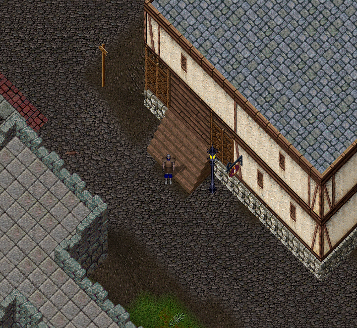

# Ultoria Oyun Rehberi

**Ultoria Oyun Rehberi**, karakter oluşturma, 58 beceri, büyü kitapları ve günlük oyun işlemleri için kullanım kaynağındır. Oyunu ilk kez tanıyorsan [Ultima Online nedir, nasıl oynanır?](https://ultoria.com/ultima-online-nedir/) sayfasından başla. Hesabını açıp dünyaya katılmak için [Ultoria](https://ultoria.com) sitesini kullan.

Hiç oynamadıysan [ilk 10 dakika](baslangic/ilk-10-dakika.md) sayfasıyla başla. Her şeyi bir günde öğrenmen gerekmez. Önce yürümeyi, çantanı açmayı ve bankanı kullanmayı dene.

*Ekranın ortasındaki karakter sensin. İlk hedefin çevreni tanımak ve eşyalarını bulmak.*

## Ultima Online nasıl bir oyun

Ultima Online, aynı dünyayı başka oyuncularla paylaştığın bir rol yapma oyunudur. Bir karakteri yönetirsin. Şehirleri gezebilir, yaratıklarla savaşabilir, eşya üretebilir veya ticaret yapabilirsin.

Oyunda önemli bir sözcük **beceri**dir. Beceri, karakterinin bir işi ne kadar iyi yaptığını anlatır. Örneğin kılıç kullanmak ve demircilik ayrı becerilerdir. [Beceriler ve gelişim](temeller/yetenekler-ve-gelisim.md) sayfası bu sistemi açıklar.

Becerileri **İngilizce (Türkçe)** biçiminde görürsün: örneğin **Swordsmanship (Kılıç ustalığı)**. Beceriler, Günlük, alış ve satış parşömenleri ile eşya özellikleri Türkçedir. Büyü adları özgün İngilizce kalır; kitap rehberlerinde Türkçe anlamlarını ve açıklamalarını da bulabilirsin.

Ultoria, Ultima Online dünyasında oynanan bu sunucunun adıdır. Bu rehberdeki komutlar ve başlangıç seçenekleri Ultoria içindir. Başka bir sunucunun kuralları farklı olabilir.

## İlk kez oynuyorum

1. [Hesap oluştur ve oyuna gir](baslangic/hesap-ve-giris.md).
2. [Karakterini oluştur](baslangic/karakter-olusturma.md).
3. [Ekranı ve fareyi kullanmayı öğren](temeller/ekran-ve-kontroller.md).
4. [Çantanı ve eşyalarını bul](temeller/canta-ve-esyalar.md).
5. [İlk 10 dakika alıştırmalarını yap](baslangic/ilk-10-dakika.md).

## Ne yapmak istiyorsun

| İstediğin | Başlayacağın rehber |
| --- | --- |
| Bir becerinin nerede ve nasıl kullanıldığını öğrenmek | [58 becerinin ayrı kullanım rehberleri](temeller/yetenekler-ve-gelisim.md) |
| Eşyanın üzerine gelince çıkan özellikleri anlamak | [Eşya özellikleri ve bilgi kutuları](temeller/esya-ozellikleri.md) |
| Kılıç veya yay kullanmak | [Savaş ve iyileşme](oynanis/savas-ve-iyilesme.md) |
| Büyü yapmak ve doğru kitabı seçmek | [Büyücülük ve 8 kitap rehberi](oynanis/buyu.md) |
| Maden çıkarmak ve eşya üretmek | [Üretim ve kaynak toplama](oynanis/uretim-ve-kaynak-toplama.md) |
| Eşya alıp satmak | [Banka ve ticaret](oynanis/banka-ve-ticaret.md) |
| At kullanmak ve hayvan yönetmek | [Hayvanlar ve binekler](oynanis/hayvanlar-ve-binekler.md) |
| Deniz yolculuğu yapmak | [Gemi kullanımı](oynanis/gemi-kullanimi.md) |
| Arkadaşlarımla gezmek | [Keşif ve birlikte oynama](oynanis/kesif-ve-birlikte-oynama.md) |

## Komutlar Türkçe mi

Evet. Örneğin bankacının yanında `banka`, satıcının yanında `al` yazabilirsin. Sana ait hayvanları çağırmak için `hepsi gel` kullanılır. Mesajı göndermek için Enter'a basarsın.

İngilizce komutlar da kullanılabilir. [Türkçe oyun komutları](referans/komutlar.md) sayfasında bütün karşılıkları ve kullanım yerlerini bulabilirsin.

## Şövalye ölü çağıran veya ozan olarak oynamak

Paladin için [Chivalry (Şövalyelik) kitabını](buyu-kitaplari/chivalry.md), Necromancer için [Necromancy (Ölü çağırma) kitabını](buyu-kitaplari/necromancy.md) aç. Klasik büyüler [Magery (Büyücülük) kitabında](buyu-kitaplari/magery.md), ozan ezgileri ve diğer ileri teknikler [ustalık kitabında](buyu-kitaplari/mastery.md) anlatılır.

Bushido (Buşido), Ninjitsu (Ninjutsu), Spellweaving (Tılsım dokuma) ve Mysticism (Mistisizm) kitaplarının da ayrı sayfaları vardır. Mevcut düzende kapalı veya sınırlı olan kullanımlar [kitap seçim tablosunda](oynanis/buyu.md) ve ilgili sayfada belirtilir.

## Takıldım nereden yardım alabilirim

- Bir kelimeyi anlamadıysan [oyun sözlüğüne](referans/terimler.md) bak.
- Oyun açılmıyorsa [sorun giderme](yardim/sorun-giderme.md) adımlarını uygula.
- Karakterin öldüyse [ölümden sonra geri dönüş](oynanis/olum-ve-geri-donus.md) sayfasını aç.
- Yazılar veya kontroller zor geliyorsa [ayarlar ve makrolar](yardim/ayarlar-ve-makrolar.md) sayfasını kullan.
- Kısa cevaplar için [sık sorulan soruları](referans/sik-sorulan-sorular.md) oku.

Başlamak için: [Ultoria'da hesap oluştur](https://ultoria.com).
