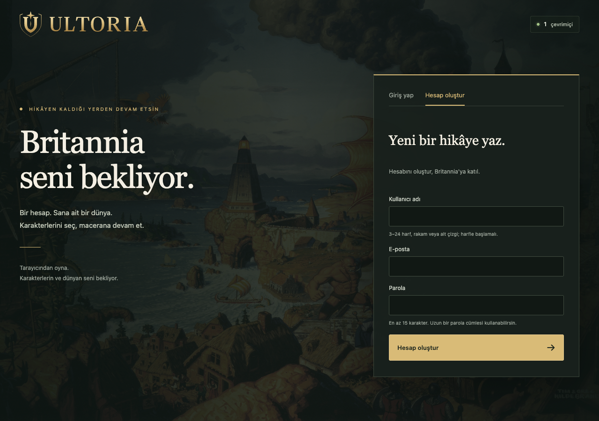
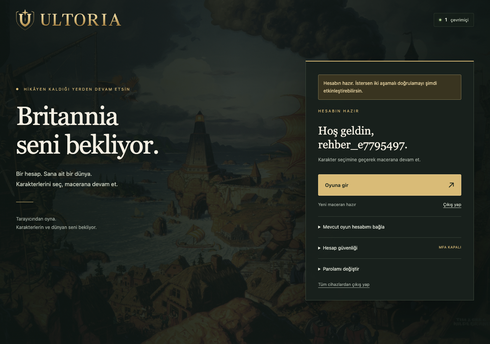

# Ultoria hesap oluşturma ve oyuna giriş

**Ultoria'ya giriş, internet sitesindeki hesabınla yapılır.** [Ultoria'yı aç](https://ultoria.com), giriş yap ve **Oyuna gir** düğmesini kullan. Oyun içinde yeniden kullanıcı adı veya sunucu seçmen gerekmez.

## Hesabını oluştur

1. Ana sayfada **Hesap oluştur** bölümünü aç.
2. Bir kullanıcı adı yaz. Adın 3–24 karakter olmalı ve harfle başlamalı. İngiliz alfabesindeki harfleri, rakamları ve alt çizgiyi kullanabilirsin.
3. E-posta adresini yaz.
4. En az 15 karakterli bir parola oluştur. Hatırlayabileceğin uzun bir parola cümlesi seç.
5. **Hesap oluştur** düğmesine bas.

*Kullanıcı adın hesabına giriş içindir. Oyunda görünecek karakter adını sonraki adımda seçersin.*

## Zaten hesabın varsa

1. **Giriş yap** bölümünü aç.
2. Kullanıcı adını veya e-posta adresini yaz.
3. Parolanı yaz.
4. İki adımlı doğrulama açıksa doğrulama uygulamandaki kodu gir. Gerekirse sakladığın kurtarma kodlarından birini kullan.
5. **Giriş yap** düğmesine bas.

Eski bir oyun hesabın varsa, hesap sayfandaki bağlama seçeneğini kontrol et. Yeni bir hesap açman eski karakterlerini kendiliğinden taşımaz.

## Oyunu aç

Hesabına girdikten sonra **Oyuna gir** düğmesine bas. İlk açılışta oyun dosyaları hazırlanır. İnternet bağlantına ve cihazına göre bu işlem zaman alabilir. İlerleme tamamlandıktan sonra oyun ekranının açılmasını bekle.

*Oyuna gir düğmesi, hesabına bağlı karakter ekranını açar.*

Dosyalar tarayıcıda saklanır. Aynı tarayıcıyla tekrar girdiğinde sağlam dosyaların yeniden indirilmesi gerekmez. Hazırlık yarıda kalırsa tekrar açıp devam edebilirsin.

Karakterin varsa listeden seç. Henüz yoksa [karakter oluşturma](karakter-olusturma.md) adımlarını izle. Hesabına giriş yapmak, bir karakteri kendiliğinden dünyaya sokmaz.

## Hesabını koru

Parolanı ve doğrulama kodlarını paylaşma. **Hesap güvenliği** bölümünden iki adımlı doğrulamayı açabilir, kurtarma kodlarını güvenli bir yerde saklayabilirsin. Ortak bir bilgisayarda işin bitince hesabından çık.

Parolanı unuttuysan [sorun giderme](../yardim/sorun-giderme.md) sayfasını oku. E-posta ile otomatik parola sıfırlama, mevcut hesap akışında kullanıma açık değildir.

Sonraki adım: [Karakterini oluştur](karakter-olusturma.md). Genel başlangıç için [Ultima Online oyna](../README.md) sayfasına dönebilirsin.
