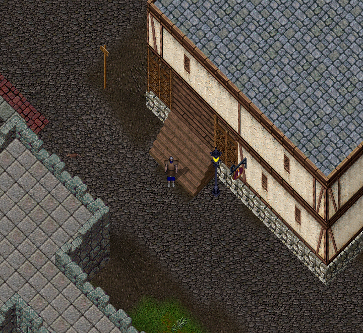
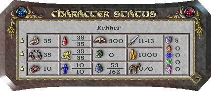

# Ultoria'da ilk 10 dakika

**İlk hedefin, karakterini hareket ettirmek ve eşyalarını bulmak.** Savaşa hemen girmen gerekmez. Aşağıdaki sırayı kendi hızında uygula; 10 dakika bir öneridir.

## 1 Çevrene bak

Oyun dünyasına girdikten sonra karakterini bul. Binalara, yollara ve yakındaki kişilere bak. Bilgisayarın yönettiği kişilere **NPC** denir. Bankacı ve satıcılar buna örnektir.

*Yürümeye başlamadan önce bulunduğun yeri tanı. Dönüş yolunu hatırlamana yardımcı olacak bir bina seç.*

## 2 Birkaç adım yürü

Fareyi gitmek istediğin yöne götür. Sağ düğmeyi basılı tut. Durmak için bırak. Başlangıçta fareyi karakterine yakın tutarak kısa adımlar at.

Bir kapı kapalıysa kapıya çift tıkla ve yeniden dene. Kontroller için [ekran ve fare kullanımı](../temeller/ekran-ve-kontroller.md) sayfasına bak.

## 3 Çantanı aç

Kendi karakterine çift tıkla. Karakter penceresindeki çantaya çift tıkla. Üst menüdeki **Envanter** seçeneği de çantanı açar.

Çantandaki bir eşyaya tek tıklayıp adına bak. Henüz tanımadığın eşyaları yere bırakma. [Çanta ve eşyalar](../temeller/canta-ve-esyalar.md) sayfasında taşıma işlemini öğrenebilirsin.

## 4 Canını kontrol et

Karakter penceresindeki **Durum** düğmesine bas. Can, dinçlik ve mana değerlerini bul.

- **Can:** Ne kadar yaralanmaya dayanabileceğin.
- **Dinçlik:** Hareket ve fiziksel eylemlerde kullandığın kaynak. Bazı durum alanlarında dayanıklılık adı da kullanılır; eşyanın sağlamlığıyla karıştırma.
- **Mana:** Büyü yaparken harcadığın enerji.

*Kırmızı damla canı, koşan kişi dinçliği, mavi simge manayı gösterir. Sayılar bu örnek karaktere aittir; kendi değerlerini oyunda oku.*

## 5 Bankayı dene

Bir bankacının yanına git. Enter'a bas, `banka` yaz ve tekrar Enter'a bas. Banka kasan açılırsa ilk oyun komutunu kullandın.

Bankacıya yakın değilsen bu komut işe yaramaz. Ekrandaki mesajları oku; gerekirse bankacıya yaklaş. [Banka ve ticaret](../oynanis/banka-ve-ticaret.md) sayfasında örnek bulabilirsin.

## 6 Bir sonraki hedefini seç

- Kılıç kullanacaksan [savaş ve iyileşme](../oynanis/savas-ve-iyilesme.md).
- Büyü kitabını deneyeceksen [büyücülük ve kitap seçimi](../oynanis/buyu.md).
- Eşya yapacaksan [üretim ve kaynak toplama](../oynanis/uretim-ve-kaynak-toplama.md).
- Belirli bir beceriyi öğrenmek istiyorsan [58 becerinin kullanım rehberleri](../temeller/yetenekler-ve-gelisim.md).
- Eşyanın üzerindeki satırları anlamıyorsan [eşya özellikleri ve bilgi kutuları](../temeller/esya-ozellikleri.md).

**Hazır mısın?** Karakterini durdurabiliyor, çantanı açabiliyor ve canını bulabiliyorsan temel adımları tamamladın.

Bir sorun olursa [sorun giderme](../yardim/sorun-giderme.md) sayfasını aç. [Ultoria başlangıç rehberine dön](../README.md).
