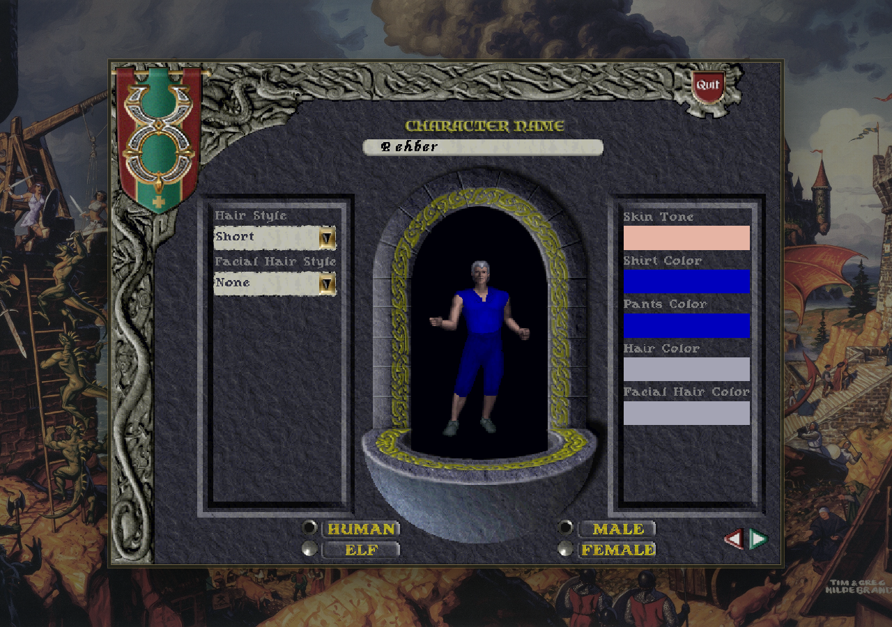
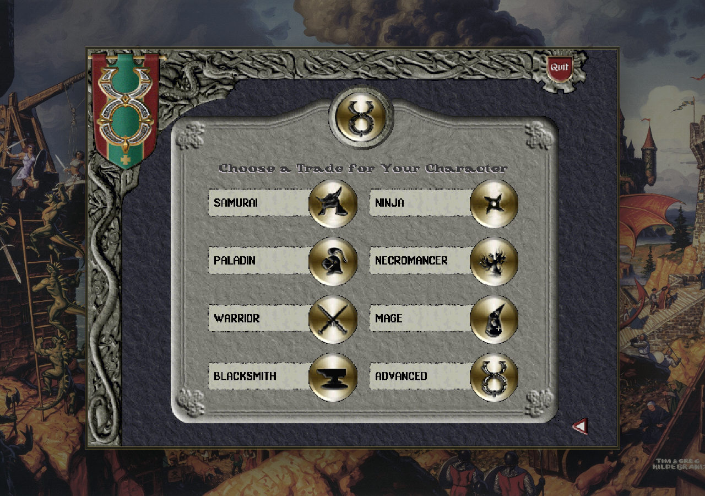

# Ultima Online karakter oluşturma

**Karakter, oyun dünyasında yönettiğin kişidir.** İlk karakterini oluştururken bir ad, görünüm ve başlangıç mesleği seçersin. Meslek seçimi, hangi beceriler ve eşyalarla başlayacağını belirler.

## Adını ve görünümünü seç

1. Karakter adı alanına oyunda kullanmak istediğin adı yaz.
2. Saçını, görünümünü ve renklerini seç.
3. Irk seçiminde **Human**, yani insanı seç.
4. İleri okuna basarak meslek ekranına geç.

*Character Name karakter adıdır. Hair Style saç biçimi, Skin Tone ten rengidir. Sağ alttaki ileri oku sonraki ekranı açar.*

Gerçek adını kullanmak zorunda değilsin. Hesabının kullanıcı adı ile karakterinin adı farklı olabilir.

## Hangi mesleği seçmeliyim

| Seçenek | Ne yapmayı sevenler için | İlk öğrenilecek konu |
| --- | --- | --- |
| Warrior (Savaşçı) | Kılıç, kalkan ve yay kullanmak | [Swordsmanship (Kılıç ustalığı)](../beceriler/swordsmanship.md) ve [savaş](../oynanis/savas-ve-iyilesme.md) |
| Mage (Büyücü) | Büyü kitabıyla oynamak | [Magery (Büyücülük) kitabı](../buyu-kitaplari/magery.md) |
| Blacksmith (Demirci) | Kaynak toplamak ve eşya yapmak | [Blacksmithy (Demircilik)](../beceriler/blacksmithy.md) ve [üretim](../oynanis/uretim-ve-kaynak-toplama.md) |
| Paladin (Şövalye) | Silahlarla ve şövalyelik büyüleriyle oynamak | [Chivalry (Şövalyelik) kitabı](../buyu-kitaplari/chivalry.md) |
| Necromancer (Ölü çağıran) | Farklı bir büyü okulu öğrenmek | [Necromancy (Ölü çağırma) kitabı](../buyu-kitaplari/necromancy.md) |

İlk kez oynuyorsan kılıç ve çanta kullanımını öğrenmek için **Savaşçı** ile başlayabilirsin. Üretim ilgini daha çok çekiyorsa **Demirci** de bir başlangıç yoludur. Bütün seçeneklerin becerilerini aynı anda öğrenmen gerekmez.

*Seçtiğin meslek başlangıç düzenini belirler. Ekrandaki İngilizce adların Türkçelerini yukarıdaki tabloda bulabilirsin.*

Mevcut başlangıç düzeninde samuray ve ninja yolları kapalıdır. [Bushido (Buşido)](../beceriler/bushido.md) ve [Ninjitsu (Ninjutsu)](../beceriler/ninjitsu.md) sayfaları bu kitapların neyi anlattığını ve kullanım durumunu açıklar. Başlamak için tablodaki kullanılabilir mesleklerden birini seç.

## Gelişmiş seçim ne işe yarar

**Advanced**, becerilerini kendin seçtiğin gelişmiş oluşturma yoludur. Hangi becerilerin birlikte çalıştığını öğrendikten sonra kullanmak daha kolaydır. İlk karakterin için hazır bir meslek seçmek, daha az ayarla başlamanı sağlar.

## Dünyaya girince

1. [Karakter penceresini ve çantanı aç](../temeller/canta-ve-esyalar.md).
2. Üzerindeki eşyaları ve çantandaki araçları tanı.
3. [Bankanı kontrol et](../oynanis/banka-ve-ticaret.md). Başlangıç malzemelerinin bir bölümü bankada bulunabilir.
4. [İlk 10 dakika](ilk-10-dakika.md) alıştırmalarını yap.

Yeni karakterlere verilen başlangıç düzeni eski karakterlerin eşyalarını kendiliğinden yenilemez. Başlangıç eşyalarını harcadıysan çantanı ve bankanı kontrol et.

İlgili rehber: [Beceriler ve gelişim](../temeller/yetenekler-ve-gelisim.md). Ana sayfa: [Ultima Online oyna](../README.md).
