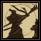
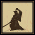
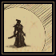
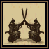
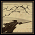
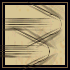

# Bushido (Buşido) kitabı

**Bushido (Buşido) kitabı**, samurayların altı dövüş tekniğini tanıtır. Mevcut başlangıç düzeninde samuray yolu kapalıdır.

## Gerekenler

Okulu destekleyen oyun düzeni, ilgili kitap, beceri ve tekniğe uygun savaş ekipmanı gerekir. Kitaptaki bir açıklamanın okunabilmesi tekniklerin açık olduğunu göstermez.

## Kitap nasıl kullanılır

1. Önce aşağıdaki kullanım durumu sütununu kontrol et.
2. Kitabın varsa tekniğin sayfasını aç ve Türkçe açıklamasını oku.
3. Desteklenen bir düzende mana ve ekipman koşullarını karşılayarak tekniği seç.
4. Sonraki uygun saldırı veya savunma eylemini gerçekleştir.
5. Mevcut düzende ret mesajı alırsan kapalı tekniği art arda deneme.

## Mevcut kullanım durumu

**Evasion (Sıyrılma)**, **Counter Attack (Karşı Saldırı)**, **Lightning Strike (Yıldırım Darbesi)** ve **Momentum Strike (İvmeli Darbe)** mevcut büyü tanımlarında kapalıdır. Diğer iki tekniğin listelenmesi de tek başına samuray yolunu açmaz.

Aşağıdaki açıklamalar tekniklerin anlamlarını öğrenmek içindir. Şimdiki karakterin için [Swordsmanship (Kılıç ustalığı)](../beceriler/swordsmanship.md), [Parrying (Savuşturma)](../beceriler/parrying.md) ve [Tactics (Taktik)](../beceriler/tactics.md) sayfalarından kullanılabilir savaş düzenini kurabilirsin.

## Büyüler ve Türkçe açıklamaları

Oyunda büyü ve teknik adları özgün İngilizce biçimlerini korur. Parantez içindeki Türkçe ad anlamını açıklar; komut veya makro seçerken İngilizce adı kullanabilirsin. Aşağıdaki açıklamalar, büyünün üzerine gelince görünen Türkçe bilgi kutularıyla aynı terimleri kullanır.

<!-- spell-catalog:start -->

| Simge | Büyü ve Türkçe anlamı | Açıklama | Kullanım durumu |
| --- | --- | --- | --- |
|  | **Honorable Execution (Onurlu İnfaz)** | Öldürücü bir darbe indirmeyi dener; başarıda saldırı hızı artar. Hedef öldürülemezse dirençler kısa süreliğine ciddi ölçüde azalır. | Diğer koşullara bağlı |
|  | **Confidence (Özgüven)** | Her başarılı savuşturmada can ve dinçlik kazandıran savunma duruşuna geçirir. | Diğer koşullara bağlı |
|  | **Evasion (Sıyrılma)** | Kısa süreliğine, ejderha nefesi ve Energy Bolt gibi büyülü saldırıları da savuşturabilen bir duruşa geçirir. | Kapalı |
|  | **Counter Attack (Karşı Saldırı)** | Sıradaki başarılı savuşturmada otomatik karşı saldırı yapmayı sağlayan savunma duruşuna geçirir. | Kapalı |
|  | **Lightning Strike (Yıldırım Darbesi)** | İsabet şansına büyük bir artış sağlayan saldırı yapar. | Kapalı |
|  | **Momentum Strike (İvmeli Darbe)** | Bir rakibe isabet edince yakındaki başka bir rakibe de otomatik saldırır. İlk rakip ölürse ek hasar kazandırır. | Kapalı |

<!-- spell-catalog:end -->

Beceri kullanımı: [Bushido (Buşido)](../beceriler/bushido.md).

Diğer kitaplar ve malzemeler: [Büyücülük ve büyü kitapları](../oynanis/buyu.md). [Ultoria rehberine dön](../README.md).
