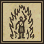
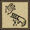
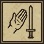
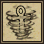
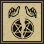
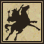

# Chivalry (Şövalyelik) kitabı

**Chivalry (Şövalyelik) kitabı**, Paladin karakterinin iyileştirme, arındırma, silah güçlendirme ve yolculuk büyülerini içerir.

## Gerekenler

Chivalry (Şövalyelik) becerisi, mana ve yeterli bağış puanı gerekir. Bazı sonuçlar karmana bağlıdır. Normal Magery (Büyücülük) malzeme listesini bu kitabın gereksinimi olarak düşünme.

## Kitap nasıl kullanılır

1. Kitabı çift tıklayarak aç.
2. Kullanılabilir bağış puanını oku.
3. İstediğin büyünün mana ve beceri koşullarını kontrol et.
4. Büyüyü kullan ve gerekiyorsa uygun hedefi seç.
5. Can, mana ve bağış puanındaki değişimi kontrol et.

## İyileştirme ve arındırmayı ayır

**Close Wounds (Yaraları Kapat)** can yenilemek içindir. **Cleanse by Fire (Ateşle Arındır)** zehri gidermeyi dener; büyücünün kendisi hasar alabilir. **Remove Curse (Lanet)** ise lanet türü olumsuz etkiler içindir. Aynı sorunu çözen üç eşdeğer düğme değildirler.

## Silah savaşında destek

**Consecrate Weapon (Silahı Kutsa)** ve **Divine Fury (İlahi Öfke)** savaş düzenini destekler. **Enemy of One (Tek Düşman)** belirlenen düşman türüne karşı avantaj sağlarken başka türlerden alınan hasarı artırabilir. Birden çok yaratık türüyle savaşmadan önce açıklamasını oku.

## Bağış puanı nasıl anlaşılır

Bağış puanı, manadan ve çantandaki altından ayrı bir değerdir. Uygun tapınak veya sunakta bağış etkileşimi sunulduğunda ayıracağın altını ve kazanacağın puanı okuyarak onayla. Kitabın olması veya banka bakiyenin yüksek olması puanı kendiliğinden doldurmaz.

**Sacred Journey (Kutsal Yolculuk)** için uygun kayıtlı konum nesnesi ve yolculuk koşulları gerekir. **Noble Sacrifice (Asil Fedakârlık)** ise kendine maliyeti bulunan bir destek büyüsüdür; kullanmadan önce açıklamasını oku.

## Büyüler ve Türkçe açıklamaları

Oyunda büyü ve teknik adları özgün İngilizce biçimlerini korur. Parantez içindeki Türkçe ad anlamını açıklar; komut veya makro seçerken İngilizce adı kullanabilirsin. Aşağıdaki açıklamalar, büyünün üzerine gelince görünen Türkçe bilgi kutularıyla aynı terimleri kullanır.

<!-- spell-catalog:start -->

| Simge | Büyü ve Türkçe anlamı | Açıklama |
| --- | --- | --- |
|  | **Cleanse by Fire (Ateşle Arındır)** | Hedefin zehrini giderir, fakat büyücü ateş hasarı alır. Büyücünün karması yükseldikçe aldığı hasar azalır. |
|  | **Close Wounds (Yaraları Kapat)** | Hedefin canını yeniler. İyileştirilen miktar büyücünün karmasına bağlıdır. |
|  | **Consecrate Weapon (Silahı Kutsa)** | Eldeki silahın hasar türünü, hedefin en düşük direncine sahip olduğu türe geçici olarak dönüştürür. Süre büyücünün karmasına bağlıdır. |
|  | **Dispel Evil (Kötülüğü Dağıt)** | Kötü çağrılmış yaratıkları dağıtmaya, diğer kötü yaratıkları kaçırmaya çalışır. Dönüşmüş nekromantlar dinçlik ve mana kaybedebilir. Şansı büyücünün karması ve Chivalry (Şövalyelik), hedefin şöhreti veya Necromancy (Ölü çağırma) etkiler. |
|  | **Divine Fury (İlahi Öfke)** | Paladinin savunmasını azaltırken saldırı hızını, isabet şansını ve hasarını geçici olarak artırır; dinçliğini yeniler. Süre karmaya bağlıdır. |
|  | **Enemy of One (Tek Düşman)** | Vurulan sıradaki hedefin türü ölümcül düşman olur. O tür yaratıklara verilen hasar artar; diğer türlerden alınan hasar da artar. Düşman türü turuncu görünür. Süre karmaya bağlıdır. |
|  | **Holy Light (Kutsal Işık)** | Büyücünün çevresindeki uygun hedeflere enerji hasarı verir. Hasar miktarı karmaya bağlıdır. |
|  | **Noble Sacrifice (Asil Fedakârlık)** | Yakındaki hedefleri diriltmeye, zehirlerini gidermeye ve iyileştirmeye çalışır. Bir hedefe yardım edilirse paladinin mevcut canı, manası ve dinçliği büyük ölçüde azalır. İyileştirme miktarı karmaya bağlıdır. |
|  | **Remove Curse (Laneti Kaldır)** | Clumsy, Weaken, Feeblemind, Paralyze ve tüm nekromansi lanetleri dâhil hedefteki lanetleri kaldırmaya çalışır. Başarı şansı karmaya bağlıdır. |
|  | **Sacred Journey (Kutsal Yolculuk)** | Bir rün veya gemi anahtarı hedeflenerek kayıtlı konuma ışınlanmayı sağlar. Savaştan kaçmak için kullanılamaz. |

<!-- spell-catalog:end -->

Beceri kullanımı: [Chivalry (Şövalyelik)](../beceriler/chivalry.md).

Diğer kitaplar ve malzemeler: [Büyücülük ve büyü kitapları](../oynanis/buyu.md). [Ultoria rehberine dön](../README.md).
