# Magery (Büyücülük) kitabı

**Magery (Büyücülük) kitabı**, klasik büyü okulunun 64 büyüsünü sekiz çemberde toplar. İyileştirme, aydınlatma, koruma, saldırı ve yolculuk için kullanılır.

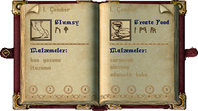

*Gerçek istemcinin örnek kitap sayfası: büyü adları İngilizce, çember ve malzeme bilgileri Türkçedir. Kitap dışındaki alan saydamdır.*

## Gerekenler

Kitabın yanında yeterli mana, ilgili büyünün kitapta kayıtlı olması ve büyü malzemeleri gerekir. Magery (Büyücülük) okulunu kapsayan malzeme kristali uygun büyülerde malzemeleri karşılayabilir; mana ve beceri yerine geçmez.

## Kitap nasıl kullanılır

1. Kitabına çift tıkla ve büyü listesini aç.
2. Listeden istediğin büyünün sayfasına geç.
3. Malzemeler, mana maliyeti ve asgari beceri bilgisini oku.
4. Büyü simgesine çift tıkla; hedef istenirse uygun kişiyi, eşyayı veya konumu seç.
5. Sonucu Günlükten ve hedefteki değişimden kontrol et.

## İlk hangi büyüleri öğrenmelisin

**Heal (Şifa)** eksik can için, **Cure (Zehri Gider)** zehir durumu için kullanılır. Birbirlerinin yerine geçmezler. **Night Sight (Gece Görüşü)** karanlık ortamda görmeyi kolaylaştırır. Başlangıçta kitabında bulunan bu tür yardımcı büyülerden birini seç.

Saldırı büyülerinde hedefin uygunluğu, görüş hattı ve mesafe önemlidir. Alan büyüsü seçerken yalnızca tek bir düşmana etki edeceğini varsayma. **Summon Creature (Yaratık Çağır)** gibi çağırmalar takipçi ve kullanım koşullarına bağlıdır.

## Yolculuk büyülerini ayır

**Mark (İşaretle)** uygun rüne konum kaydeder. **Recall (Geri Çağırma)** kayıtlı konuma yolculuk içindir. **Gate Travel (Geçit Aç)** geçit oluşturur. **Teleport (Işınlanma)** ise yakınındaki uygun bir noktaya gitmek için kullanılır. Rün, hedef ve bölge koşulları farklıdır; hepsini aynı yolculuk düğmesi gibi kullanma.

## Çember ne demek

Her çember sekiz büyü içerir. Sonraki çemberler genel olarak daha yüksek beceri ve kaynak ister. Kitabın ilk sayfasında bir büyünün görünmesi, bütün çemberlerin karakterin için hazır olduğu anlamına gelmez.

## Büyüler ve Türkçe açıklamaları

Oyunda büyü ve teknik adları özgün İngilizce biçimlerini korur. Parantez içindeki Türkçe ad anlamını açıklar; komut veya makro seçerken İngilizce adı kullanabilirsin. Aşağıdaki açıklamalar, büyünün üzerine gelince görünen Türkçe bilgi kutularıyla aynı terimleri kullanır.

<!-- spell-catalog:start -->

### 1. çember

| Simge | Büyü ve Türkçe anlamı | Açıklama |
| --- | --- | --- |
|  | **Clumsy (Sakarlık)** | Hedefin çevikliğini geçici olarak azaltır. |
|  | **Create Food (Yiyecek Yarat)** | Büyücünün çantasında rastgele bir yiyecek oluşturur. |
|  | **Feeblemind (Akıl Bulanıklığı)** | Hedefin zekâsını geçici olarak azaltır. |
|  | **Heal (Şifa)** | Hedefin kaybettiği canın küçük bir kısmını yeniler. |
|  | **Magic Arrow (Büyülü Ok)** | Hedefe ateş hasarı veren büyülü bir ok fırlatır. |
|  | **Night Sight (Gece Görüşü)** | Hedefin bir süre karanlıkta görmesini sağlar. |
| 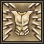 | **Reactive Armor (Tepkisel Zırh)** | Büyücünün fiziksel direncini artırırken element dirençlerini azaltır. Inscription (Yazıt işleme) becerisi fiziksel direnç artışına ek katkı sağlar. Aynı hedefe yeniden uygulanarak kapatılana kadar sürer. |
|  | **Weaken (Zayıflat)** | Hedefin gücünü geçici olarak azaltır. |

### 2. çember

| Simge | Büyü ve Türkçe anlamı | Açıklama |
| --- | --- | --- |
|  | **Agility (Çeviklik)** | Hedefin çevikliğini geçici olarak artırır. |
|  | **Cunning (Zekâ)** | Hedefin zekâsını geçici olarak artırır. |
|  | **Cure (Zehri Gider)** | Hedefteki zehri etkisiz hâle getirmeye çalışır. |
| 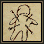 | **Harm (Zarar Ver)** | Hedefe soğuk hasarı verir. Hedef büyücüye ne kadar yakınsa hasar o kadar artar. |
| 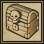 | **Magic Trap (Büyülü Tuzak)** | Kullanılabilir bir nesneye, onu sıradaki kullanan kişiye ateş hasarı veren patlayıcı bir büyü tuzağı yerleştirir. |
| 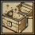 | **Magic Untrap (Büyülü Tuzağı Kaldır)** | Bir nesnenin üzerindeki büyülü tuzağı etkisiz hâle getirir. |
|  | **Protection (Koruma)** | Hedefin büyülerinin kesilmesini önler; fiziksel direncini ve Resisting Spells (Büyü direnci) becerisini azaltır. Aynı hedefe yeniden uygulanarak kapatılana kadar sürer. |
|  | **Strength (Güç)** | Hedefin gücünü geçici olarak artırır. |

### 3. çember

| Simge | Büyü ve Türkçe anlamı | Açıklama |
| --- | --- | --- |
|  | **Bless (Kutsama)** | Hedefin gücünü, çevikliğini ve zekâsını geçici olarak artırır. |
| 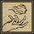 | **Fireball (Ateş Topu)** | Hedefe ateş hasarı veren bir alev topu fırlatır. |
| 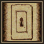 | **Magic Lock (Büyülü Kilit)** | Bir kabı büyüyle kilitler. Kilit büyüyle açılana kadar kap kullanılamaz. |
|  | **Poison (Zehir)** | Hedefi zehirler. Zehrin gücü büyücünün Magery (Büyücülük) ve Poisoning (Zehirleme) becerileri ile hedefe uzaklığına bağlıdır. |
|  | **Telekinesis (Telekinezi)** | Büyücünün uzaktaki bir nesneyi kullanmasını sağlar. |
|  | **Teleport (Işınlanma)** | Büyücüyü hedeflenen konuma taşır. |
| 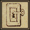 | **Magic Unlock (Büyülü Kilidi Aç)** | Büyülü bir kilidi veya basit bir normal kilidi açar. |
|  | **Wall of Stone (Taş Duvar)** | Hareketi engelleyen geçici bir taş duvar oluşturur. |

### 4. çember

| Simge | Büyü ve Türkçe anlamı | Açıklama |
| --- | --- | --- |
|  | **Arch Cure (Toplu Zehir Giderme)** | Büyücünün çevresindeki küçük bir alanda bulunan tüm karakterlerin zehrini giderir. |
| 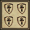 | **Arch Protection (Toplu Koruma)** | Hedef konumun çevresindeki küçük bir alanda bulunan uygun hedeflere Protection uygular. |
|  | **Curse (Lanet)** | Hedefin gücünü, çevikliğini ve zekâsını azaltır. Oyuncular arası savaşta hedefin azami dirençlerini de düşürür. |
|  | **Fire Field (Ateş Duvarı)** | İçinden geçenlere ateş hasarı veren bir alev duvarı çağırır. |
| 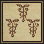 | **Greater Heal (Büyük Şifa)** | Hedefin kaybettiği canın orta büyüklükte bir kısmını yeniler. |
|  | **Lightning (Yıldırım)** | Hedefi enerji hasarı veren bir yıldırımla vurur. |
|  | **Mana Drain (Mana Boşaltma)** | Hedefin manasının bir kısmını geçici olarak kaldırır. Miktar, büyücünün Evaluating Intelligence (Zekâ değerlendirme) becerisi ile hedefin Resisting Spells (Büyü direnci) becerisinin karşılaştırılmasına bağlıdır. |
|  | **Recall (Geri Çağırma)** | Büyücüyü hedeflenen ründe kayıtlı konuma taşır. Bir gemi anahtarı hedeflenirse anahtarın ait olduğu gemiye taşır. |

### 5. çember

| Simge | Büyü ve Türkçe anlamı | Açıklama |
| --- | --- | --- |
| 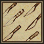 | **Blade Spirit (Kılıç Ruhu)** | Yakınlığına ve savaş gücüne göre hedef seçip saldıran, dönen bir kılıç sütunu çağırır. Bir süre sonra kaybolur. 2 takipçi yuvası gerektirir. |
|  | **Dispel Field (Büyü Alanını Dağıt)** | Hedeflenen alan büyüsünün bir karesini yok eder. |
|  | **Incognito (Kimlik Gizleme)** | Büyücünün görünüşünü ve adını rastgele değiştirerek kimliğini gizler. |
| 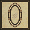 | **Magic Reflection (Büyü Yansıtma)** | Büyücünün fiziksel direncini azaltırken element dirençlerini artırır. Aynı hedefe yeniden uygulanarak kapatılana kadar sürer. |
|  | **Mind Blast (Zihin Patlaması)** | Büyücünün Magery (Büyücülük) becerisi ve zekâsına bağlı olarak hedefe soğuk hasarı verir. |
|  | **Paralyze (Felç)** | Hedefi kısa süreliğine hareketsiz bırakır. Süre, hedefin Resisting Spells (Büyü direnci) becerisine bağlıdır. |
|  | **Poison Field (Zehir Duvarı)** | İçinden geçenleri zehirleyen bir buhar duvarı oluşturur. Zehrin gücü büyücünün Magery (Büyücülük) ve Poisoning (Zehirleme) becerilerine bağlıdır. |
|  | **Summon Creature (Yaratık Çağır)** | Sınırlı bir süreliğine rastgele bir yaratığı takipçi olarak çağırır. Yaratığın gücü büyücünün Magery (Büyücülük) becerisine bağlıdır. |

### 6. çember

| Simge | Büyü ve Türkçe anlamı | Açıklama |
| --- | --- | --- |
| 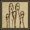 | **Dispel (Büyüyü Dağıt)** | Çağrılmış bir yaratığı dünyadan uzaklaştırmaya çalışır. Zorluk, yaratığı çağıranın Magery (Büyücülük) becerisine bağlıdır. |
|  | **Energy Bolt (Enerji Oku)** | Hedefe enerji hasarı veren büyülü bir güç oku fırlatır. |
| 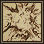 | **Explosion (Patlama)** | Hedefi ateş hasarı veren patlayıcı bir enerji darbesiyle vurur. |
|  | **Invisibility (Görünmezlik)** | Hedefi geçici olarak görünmez yapar. |
|  | **Mark (İşaretle)** | Bir rünü büyücünün bulunduğu konuma bağlar. Bu rün, Recall veya Sacred Journey ile kayıtlı konuma ışınlanmak için kullanılabilir. |
| 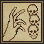 | **Mass Curse (Toplu Lanet)** | Hedefe ve iki karelik çevresindeki yaratıklara Curse uygular. |
|  | **Paralyze Field (Felç Alanı)** | İçine giren yaratıklara Paralyze etkisi uygulayan bir enerji alanı oluşturur. |
|  | **Reveal (Ortaya Çıkar)** | Hedeflenen karenin çevresindeki görünmez veya saklanan yaratıkları ve oyuncuları açığa çıkarır. |

### 7. çember

| Simge | Büyü ve Türkçe anlamı | Açıklama |
| --- | --- | --- |
| 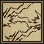 | **Chain Lightning (Zincirleme Yıldırım)** | Yakındaki hedefleri enerji hasarı veren bir yıldırım dizisiyle vurur. |
| 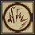 | **Energy Field (Enerji Alanı)** | Hedeflenen konumda tüm hareketi engelleyen geçici bir enerji alanı oluşturur. |
| 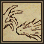 | **Flamestrike (Alev Darbesi)** | Hedefi ateş hasarı veren büyülü bir alev sütunuyla sarar. |
| 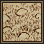 | **Gate Travel (Geçit Aç)** | Mark ile işaretlenmiş bir rün hedeflendiğinde kayıtlı konuma geçici bir geçit açar. Geçidi herkes kullanabilir. |
|  | **Mana Vampire (Mana Vampiri)** | Hedefin manasını büyücüye aktarır. Miktar, büyücünün Evaluating Intelligence (Zekâ değerlendirme) becerisi ile hedefin Resisting Spells (Büyü direnci) becerisinin karşılaştırılmasına bağlıdır. |
|  | **Mass Dispel (Toplu Dağıtma)** | Sekiz karelik alandaki çağrılmış yaratıkları dağıtmaya çalışır. |
| 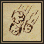 | **Meteor Swarm (Meteor Yağmuru)** | Hedef konumun çevresine ateşli meteorlar yağdırır. Toplam ateş hasarı, büyünün tüm hedefleri arasında paylaşılır. |
|  | **Polymorph (Biçim Değiştirme)** | Büyücüyü bir listeden seçilen yaratığa geçici olarak dönüştürür. Bu biçimdeyken diğer oyuncular büyücüyü suçlu olarak görür. |

### 8. çember

| Simge | Büyü ve Türkçe anlamı | Açıklama |
| --- | --- | --- |
| 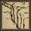 | **Earthquake (Deprem)** | Yakındaki tüm yaratıklara ve karakterlere hasar veren şiddetli bir sarsıntı oluşturur. |
|  | **Energy Vortex (Enerji Girdabı)** | Yakınlığına ve zekâsına göre hedef seçip saldıran bir enerji girdabı çağırır. Bir süre sonra kaybolur. 2 takipçi yuvası gerektirir. |
|  | **Resurrection (Diriltme)** | Bir oyuncunun hayaletini diriltir. NPC veya canavarlarda kullanılamaz. |
| 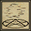 | **Air Elemental (Hava Elementali)** | Büyücüye hizmet eden bir hava elementali çağırır. 2 takipçi yuvası gerektirir. |
| 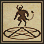 | **Summon Daemon (İblis Çağır)** | Büyücüye hizmet eden bir iblis çağırır ve büyük miktarda karma kaybettirir. 4 takipçi yuvası gerektirir. |
| 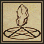 | **Earth Elemental (Toprak Elementali)** | Büyücüye hizmet eden bir toprak elementali çağırır. 2 takipçi yuvası gerektirir. |
| 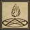 | **Fire Elemental (Ateş Elementali)** | Büyücüye hizmet eden bir ateş elementali çağırır. 4 takipçi yuvası gerektirir. |
| 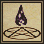 | **Water Elemental (Su Elementali)** | Büyücüye hizmet eden bir su elementali çağırır. 3 takipçi yuvası gerektirir. |

<!-- spell-catalog:end -->

Beceri kullanımı: [Magery (Büyücülük)](../beceriler/magery.md).

Diğer kitaplar ve malzemeler: [Büyücülük ve büyü kitapları](../oynanis/buyu.md). [Ultoria rehberine dön](../README.md).
