# Book of Masteries (Ustalık kitabı)

**Book of Masteries (Ustalık kitabı)**, yalnızca tek bir büyü okuluna ait olmayan ileri beceri tekniklerini toplar. Ozan ezgileri ile silah, savunma, hayvan ve büyü ustalıkları aynı kitap ailesinde yer alır.

## Gerekenler

İlgili becerinin ustalık koşulu, uygun kitap ve seçilmiş ustalık gerekir. Aktif teknikler mana veya sürdürme maliyeti isteyebilir; pasif teknikler ayrı çalışır.

## Kitap nasıl kullanılır

1. Ustalık kitabını aç ve hangi beceri ustalığının seçili olduğunu kontrol et.
2. Kitabın bağlam menüsünde ustalık değiştirme seçeneği sunulursa aç.
3. Becerine uygun ustalığı seç; koşulu karşılamıyorsan gelen mesajı oku.
4. Tekniğin aktif, sürdürülen veya pasif olduğunu açıklamasından öğren.
5. Aktif tekniği kullanırken mana ve sürdürme durumunu takip et.

## Ozan ustalıkları

**Inspire (İlham)** ve **Invigorate (Canlandırma)** kışkırtma; **Resilience (Dirayet)** ve **Perseverance (Sebat)** yatıştırma; **Tribulation (Azap)** ve **Despair (Umutsuzluk)** ahenksizlik ustalığıyla ilişkilidir. Bir ezginin grup desteği vermesi, temel müzik aletine çift tıklamanın aynı etkiyi oluşturduğu anlamına gelmez.

Temel becerileri önce öğren: [Musicianship (Müzisyenlik)](../beceriler/musicianship.md), [Provocation (Kışkırtma)](../beceriler/provocation.md), [Peacemaking (Yatıştırma)](../beceriler/peacemaking.md), [Discordance (Ahenksizlik)](../beceriler/discordance.md).

## Diğer becerilerin ustalıkları

Kitapta büyü, yakın dövüş, okçuluk, zehir, savunma ve hayvan yönetimine ait teknikler de bulunur. **Shield Bash (Kalkan Darbesi)** ile **Whispering (Fısıldama)** aynı ekipmanı veya beceriyi istemez. Açıklamayı kendi beceri düzeninle birlikte değerlendir.

## Kitaptaki teknik ile açık kullanım ayrımı

Listede 45 açıklama bulunur. Bir tekniğin listelenmesi, karakterinin onu öğrendiğini veya mevcut oyun düzeninin tamamını desteklediğini göstermez. Özellikle ileri okul ve kapalı başlangıçlara ait tekniklerde okulun kullanım durumunu da kontrol et. Kitabı açmak, seçili ustalığı değiştirmek ve tekniğin etkisini uygulamak ayrı adımlardır.

## Büyüler ve Türkçe açıklamaları

Oyunda büyü ve teknik adları özgün İngilizce biçimlerini korur. Parantez içindeki Türkçe ad anlamını açıklar; komut veya makro seçerken İngilizce adı kullanabilirsin. Aşağıdaki açıklamalar, büyünün üzerine gelince görünen Türkçe bilgi kutularıyla aynı terimleri kullanır.

<!-- spell-catalog:start -->

| Simge | Büyü ve Türkçe anlamı | Açıklama |
| --- | --- | --- |
| 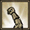 | **Inspire (İlham)** | Yakındaki grup üyelerinin isabet şansını, silah ve büyü hasarını artıran bir ozan ezgisidir. |
| 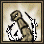 | **Invigorate (Canlandırma)** | Grup üyelerinin azami canını ve niteliklerini artırır; düzenli olarak can yeniler. |
|  | **Resilience (Dirayet)** | Grubun can, mana ve dinçlik yenilenmesini artırır; zehre dayanıklılık sağlar ve bazı olumsuz etkilerin süresini kısaltır. |
| 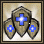 | **Perseverance (Sebat)** | Grup üyelerinin savunma şansını artırır, aldıkları hasarı azaltır ve büyü odaklanmalarını güçlendirir. |
| 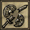 | **Tribulation (Azap)** | Hedefin isabet şansını ve büyü hasarını azaltır. Hedefin aldığı darbeler ek fiziksel hasar tetikleyebilir. |
| 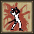 | **Despair (Umutsuzluk)** | Hedef menzilde kaldığı ve ozanın manası yettiği sürece hedefin gücünü azaltır ve düzenli hasar verir. |
| 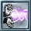 | **Death Ray (Ölüm Işını)** | Büyücü yerinden hareket edemeden hedefe sürekli hasar veren bir ışın odaklar. Hedef menzilde ve yeterli mana olduğu sürece sürer. |
|  | **Ethereal Burst (Ruhani Patlama)** | Ustalık düzeyine bağlı olarak büyük miktarda mana yeniler. |
|  | **Nether Blast (Hiçlik Patlaması)** | Saldırılan hedeflere aralıklarla kaos hasarı veren hiçlik enerjisi yayar; etkilenen hedeflerden mana da emebilir. |
| 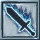 | **Mystic Weapon (Mistik Silah)** | Mysticism (Mistisizm) becerisinin bir kısmını azaltma karşılığında, eldeki silahın gerektirdiği beceri yerine kullanılmasını sağlar. |
| 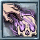 | **Command Undead (Ölüye Hükmet)** | Bir ölü yaratığı kontrol etmeye çalışır ve ona can emme etkisi kazandırır. 2 takipçi yuvası gerektirir. |
|  | **Conduit (Karanlık Kanal)** | Blood Oath dışındaki hedefli nekromansi büyülerinin, azaltılmış güçle alandaki uygun hedeflere uygulanmasını sağlayan bir alan oluşturur. |
|  | **Mana Shield (Mana Kalkanı)** | Açıkken gelen hasarın bir kısmını can yerine manadan karşılama şansı sağlayan bir kalkan oluşturur. |
| 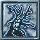 | **Summon Reaper (Ağaç Yaratığı Çağır)** | Büyücü için savaşan, bulunduğu yerde sabit duran bir ağaç yaratığı çağırır. |
|  | **Enchanted Summoning (Güçlendirilmiş Çağırma)** | Etkin büyücülük ustalığının düzeyine göre çağrılan yaratıkları güçlendiren pasif bir yetenektir. |
|  | **Anticipate Hit (Darbeyi Sez)** | Confidence kullanırken can yenilenmesini koruma şansı sağlar; başarılı savuşturmalarda yenilenen canı ve dinçliği artırır. |
|  | **Warcry (Savaş Narası)** | Yakındaki düşmanlardan alınan hasarı azaltan bir savaş narası atar. |
|  | **Intuition (Sezgi)** | Etkin savaşçı uzmanlığının ustalık düzeyine göre manayı artıran pasif bir yetenektir. |
|  | **Rejuvenate (Tazelenme)** | Hedefin canını, dinçliğini ve manasını yeniler. Yeterli karma ile zehir ve lanetleri de kaldırabilir. |
|  | **Holy Fist (Kutsal Yumruk)** | Hedefe enerji hasarı veren ve onu yavaşlatabilen kutsal bir darbe gönderir. Yüksek karma ve ölü hedefler hasar avantajı sağlar. |
|  | **Shadow (Gölge)** | Hasar veya açığa çıkarma etkileriyle gizliliğin bozulmasını zorlaştırır. Sürdürmek için mana tüketir. |
|  | **White Tiger Form (Beyaz Kaplan Biçimi)** | Savunma ve saldırıdan sıyrılma avantajları sağlayan, hedeflerde kanamaya yol açabilen beyaz bir kaplana dönüştürür. |
| 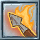 | **Flaming Shot (Alevli Atış)** | Hedefe veya seçilen alana, çevredeki düşmanlara ateş hasarı veren alevli oklar fırlatır. |
| 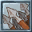 | **Playing The Odds (Olasılıkları Kullan)** | Okçunun menzilini azaltırken yakındaki grup üyelerinin saldırı hızını ve isabet şansını artırır; düşmanların savunmasını azaltabilir. |
|  | **Thrust (Atılma)** | Açıkken mana tüketerek kendi fiziksel saldırı hasarını artırır ve hedefin fiziksel saldırı hasarını azaltır. Feint ile birleşmez. |
|  | **Pierce (Delip Geç)** | Hedefin dinçliğini azaltan ve dinçlik değerine olumsuz etki uygulayan delici bir saldırı yapar. |
| 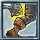 | **Stagger (Sendelet)** | Hedefe yüksek hasar veren ve saldırı hızını azaltan bir darbe indirir. |
| 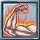 | **Toughness (Sağlamlık)** | Açıkken mana tüketerek azami canı artırır. |
|  | **Onslaught (Hücum)** | Art arda saldırılarla, kullanılan silahın hasar türüne bağlı olarak hedefin dirençlerinden birini azaltır. |
| 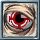 | **Focused Eye (Odaklı Bakış)** | Açıkken mana tüketerek isabet şansını artırır. |
|  | **Elemental Fury (Element Öfkesi)** | Başarılı saldırılarla silahın hasar türüne bağlı öfke biriktirir. Birikim dolunca güçlü bir element saldırısı açığa çıkar. |
| 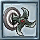 | **Called Shot (Hedefli Atış)** | İsabet şansı ve hasar artışı sağlayan dikkatle hedeflenmiş bir atış yapar. |
| 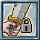 | **Warrior's Gifts (Savaşçının Armağanları)** | Etkin silah ustalığının düzeyine göre isabet, savunma, güç ve hasar avantajları sağlayan pasif bir yetenektir. |
|  | **Shield Bash (Kalkan Darbesi)** | Başarılı vuruş veya savuşturma sonrasında fiziksel hasar verebilen, hedefi felç edebilen ve büyüsünü kesebilen bir kalkan darbesi yapar. |
|  | **Bodyguard (Koruyucu)** | Seçilen korunan hedefin aldığı hasarın bir kısmını kendi üzerine alır. |
|  | **Heighten Senses (Keskin Duyular)** | Açıkken mana tüketerek savuşturma şansını artırır. |
|  | **Tolerance (Zehir Toleransı)** | Zehirlendiğinde dinçlik harcayarak zehrin seviyesini azaltmayı sağlayan bir yetenektir. |
| 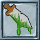 | **Injected Strike (Zehir Enjeksiyonu)** | Hedefin zehir direncini azaltır ve silahtaki zehri hedefe uygular. Diğer özel saldırılarla birlikte kullanılamaz. |
|  | **Potency (Zehir Gücü)** | Injected Strike kullanılırken silahtaki zehir yükünün harcanmaması için pasif bir şans sağlar. |
|  | **Rampage (Azgın Saldırı)** | Art arda başarılı vuruşlarla can ve dinçlik yenilenmesi, büyü odaklanması ve saldırı hızı kazandırır. Başarısız bir saldırı etkiyi bozar. |
|  | **Fists of Fury (Öfke Yumrukları)** | Yakından sana hasar veren sıradaki hedefe hızla üç yumruk atmayı dener. Başarılı olursa üçüncü yumruk doğrudan hasar verir. |
|  | **Knockout (Nakavt)** | Etkin güreş ustalığı sırasında her vuruşun hasarını artıran pasif bir yetenektir. |
|  | **Whispering (Fısıldama)** | Evcil hayvanın beceri kazanımını artırır. Kullanıldığında sahibinin gizliliği bozulur. |
|  | **Combat Training (Savaş Eğitimi)** | Ustalık düzeyine göre evcil hayvana ek savaş yetenekleri kazandırır. Kullanıldığında sahibinin gizliliği bozulur. |
|  | **Boarding (Ahır Ustalığı)** | Etkin evcilleştirme ustalığı sırasında ahır kapasitesini artıran pasif bir yetenektir. |

<!-- spell-catalog:end -->

Ustalık simgeleri: [Ultima Online resmî ustalık rehberi](https://uo.com/wiki/ultima-online-wiki/skills/skill-masteries/) ve [ozan ustalıkları](https://uo.com/wiki/ultima-online-wiki/skills/bardic-skills/bard-masteries/).

Diğer kitaplar ve malzemeler: [Büyücülük ve büyü kitapları](../oynanis/buyu.md). [Ultoria rehberine dön](../README.md).
