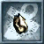
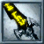
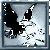
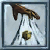
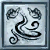
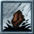
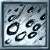
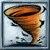
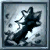

# Mysticism (Mistisizm) kitabı

**Mysticism (Mistisizm) kitabı**, mistik saldırı, iyileştirme nesnesi, dönüşüm ve çağırma büyülerini tanıtır. Bu ileri okul mevcut klasik istemcinin beceri listesinde sunulmayabilir.

## Gerekenler

Okulu destekleyen istemci ve sunucu düzeni, ilgili kitap, kayıtlı büyü, mana ve büyünün diğer gereksinimleri gerekir.

## Kitap nasıl kullanılır

1. Önce okulun karakterinde ve kitap seçeneklerinde kullanılabilir olduğunu kontrol et.
2. Kitabın varsa büyü sayfasını aç.
3. Büyünün nesne oluşturma, doğrudan hedefleme veya çağırma türünde olduğunu oku.
4. Koşulları karşılanan büyüyü seç ve istenen hedefi göster.
5. Oluşan nesneyi veya etkiyi kontrol et; kullanım reddedilirse Günlüğü oku.

## Nesne ve doğrudan büyü ayrımı

**Healing (İyileştirme) Stone (Şifa Taşı)** doğrudan bir Heal düğmesiyle aynı kullanım değildir; önce bir nesne oluşturur. **Spell Trigger (Büyü Tetikleyici)** de saklanan büyü ve nesne kullanımını anlatır. **Purge Magic (Büyüyü Arındır)** hedefteki olumlu büyü etkilerini gidermeye yöneliktir.

**Stone Form (Taş Biçimi)** avantajları ve hız maliyeti olan bir dönüşümdür. **Animated Weapon (Canlanan Silah)** ve **Rising Colossus (Yükselen Dev)** çağırma örnekleridir. Kitap adını görmek veya Türkçe açıklamayı okumak, gerekli okul desteğinin bulunduğu anlamına gelmez.

## Büyüler ve Türkçe açıklamaları

Oyunda büyü ve teknik adları özgün İngilizce biçimlerini korur. Parantez içindeki Türkçe ad anlamını açıklar; komut veya makro seçerken İngilizce adı kullanabilirsin. Aşağıdaki açıklamalar, büyünün üzerine gelince görünen Türkçe bilgi kutularıyla aynı terimleri kullanır.

<!-- spell-catalog:start -->

| Simge | Büyü ve Türkçe anlamı | Açıklama |
| --- | --- | --- |
|  | **Nether Bolt (Hiçlik Oku)** | Hedefe kaos hasarı veren bir hiçlik enerjisi oku fırlatır. |
|  | **Healing Stone (Şifa Taşı)** | Büyücünün kendini iyileştirmek ve zehrini gidermek için kullanabileceği, sınırlı şifa gücüne sahip bir taş oluşturur. |
|  | **Purge Magic (Büyüyü Arındır)** | Hedefteki yararlı büyü etkilerinden birini kaldırmaya çalışır. Kaldırılacak etki yoksa mana kullanımını bozan bir lanet uygulayabilir. |
|  | **Enchant (Efsunlama)** | Bir silaha seçilen büyüyü vuruş sırasında tetikleme özelliği kazandırır. |
|  | **Sleep (Uyku)** | Hedefin hareketini ve büyü yapmasını yavaşlatıp isabet ve savunma şansını azaltır. Hedef hasar alınca etki sona erer. |
|  | **Eagle Strike (Kartal Darbesi)** | Hedefe enerji hasarı veren büyülü bir kartal gönderir. |
|  | **Animated Weapon (Canlanan Silah)** | Yakın düşmanlara saldıran büyülü bir silah çağırır. 4 takipçi yuvası gerektirir. |
|  | **Stone Form (Taş Biçimi)** | Dirençleri ve fiziksel saldırıları güçlendiren taş biçimine dönüştürür; saldırı ve büyü yapma hızını azaltır. |
|  | **Spell Trigger (Büyü Tetikleyici)** | Daha sonra anında kullanılabilmesi için bir Mysticism (Mistisizm) büyüsünü büyü taşına kaydeder. |
|  | **Mass Sleep (Toplu Uyku)** | Hedef konumun çevresindeki uygun hedeflere Sleep uygular. Hasar alınması uyku etkisini bozar. |
|  | **Cleansing Winds (Arındırıcı Rüzgârlar)** | Hedefleri iyileştirmeye, zehirlerini gidermeye ve lanetlerini kaldırmaya çalışan rüzgârlar çağırır. |
|  | **Bombard (Bombardıman)** | Hedefe fiziksel hasar veren, onu geri savurup sersemletebilen bir kaya fırlatır. |
|  | **Spell Plague (Büyü Vebası)** | Hedefe kaos hasarı verir ve sonraki darbelerin ek patlamalar tetikleyebildiği bir lanet uygular. |
|  | **Hail Storm (Dolu Fırtınası)** | Hedef konumun çevresindeki düşmanlara soğuk hasarı veren bir dolu fırtınası oluşturur. |
|  | **Nether Cyclone (Hiçlik Kasırgası)** | Alandaki hedeflere kaos hasarı veren, mana ve dinçliklerini azaltan bir kasırga çağırır. |
|  | **Rising Colossus (Yükselen Dev)** | Büyücü için savaşan güçlü bir dev çağırır. 5 takipçi yuvası gerektirir. |

<!-- spell-catalog:end -->

İleri okul simgeleri: [Ultima Online resmî Mysticism rehberi](https://uo.com/wiki/ultima-online-wiki/skills/mysticism/).

Beceri kullanımı: [Mysticism (Mistisizm)](../beceriler/mysticism.md).

Diğer kitaplar ve malzemeler: [Büyücülük ve büyü kitapları](../oynanis/buyu.md). [Ultoria rehberine dön](../README.md).
