# Necromancy (Ölü çağırma) kitabı

**Necromancy (Ölü çağırma) kitabı**, Necromancer karakterinin karanlık büyü okuludur. Lanet, hasar, ceset kullanımı, yardımcı çağırma ve dönüşüm büyülerini içerir.

## Gerekenler

Necromancy (Ölü çağırma) becerisi, mana, kitapta bulunan büyü ve okulun malzemeleri gerekir. Spirit Speak (Ruhlarla konuşma) bu okulun önemli destek becerisidir. Kristal kullanıyorsan Necromancy (Ölü çağırma) okulunu kapsadığını kontrol et.

## Kitap nasıl kullanılır

1. Necromancy (Ölü çağırma) kitabını çantanda bul ve çift tıkla.
2. Büyünün sayfasını açıp Türkçe bilgi kutusunu oku.
3. Mana ve malzemelerini kontrol et.
4. Büyüyü kullan; hedef isteyen büyüde uygun canlıyı veya cesedi seç.
5. Dönüşüm yaptıysan can, mana ve direnç değişikliklerini kontrol et.

## Hangi durumda kullanılır

**Curse Weapon (Lanetli Silah)** silah kullanan karakter için kısa süreli destektir. **Pain Spike (Acı Darbesi)** ve **Poison Strike (Zehir Darbesi)** saldırı amaçlıdır. **Animate Dead (Ölüyü Canlandır)** uygun ceset ister; bunu ölmüş oyuncuyu dirilten **Resurrection (Diriltme)** ile karıştırma.

## Dönüşümlerini dikkatle seç

**Horrific Beast (Korkunç Canavar)**, **Lich Form (Liç Biçimi)**, **Vampiric Embrace (Vampir Kucaklaması)** ve **Wraith Form (Hortlak Biçimi)** farklı durumlar sağlar. Bir biçimin mana avantajı başka bir dirençte zayıflık yaratabilir. Can ve mana çubuklarını dönüşümden sonra yeniden oku.

## Okulun malzemeleri

Yarasa kanadı, iblis kanı, mezar tozu, zehir kristali ve ham demir bu okulun malzemeleridir. Her büyü hepsini istemez; büyü sayfasındaki listeyi esas al. Magery (Büyücülük) malzemeleriyle aynı listeyi kullandığını varsayma.

## Büyüler ve Türkçe açıklamaları

Oyunda büyü ve teknik adları özgün İngilizce biçimlerini korur. Parantez içindeki Türkçe ad anlamını açıklar; komut veya makro seçerken İngilizce adı kullanabilirsin. Aşağıdaki açıklamalar, büyünün üzerine gelince görünen Türkçe bilgi kutularıyla aynı terimleri kullanır.

<!-- spell-catalog:start -->

| Simge | Büyü ve Türkçe anlamı | Açıklama |
| --- | --- | --- |
| 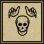 | **Animate Dead (Ölüyü Canlandır)** | Hedeflenen cesedi, akılsızca dolaşan bir ölüye dönüştürür. Canlandırılan ölünün gücünü, eski yaratığın şöhreti büyük ölçüde etkiler. |
|  | **Blood Oath (Kan Yemini)** | Büyücü ile hedef arasında geçici bir karanlık bağ kurar. Hedefin büyücüye verdiği hasar artar; hedef de aynı miktarda hasar alır. |
| 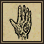 | **Corpse Skin (Ceset Derisi)** | Hedefin derisini çürümüş ete dönüştürür. Ateş ve zehir direnci azalırken fiziksel ve soğuk direnci artar. |
| 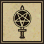 | **Curse Weapon (Lanetli Silah)** | Bir silaha geçici olarak can emme etkisi kazandırır. |
| 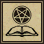 | **Evil Omen (Kötü Alamet)** | Hedefi lanetleyerek başına gelecek sıradaki zararlı etkinin gücünü artırır. |
| 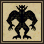 | **Horrific Beast (Korkunç Canavar)** | Büyücüyü daha çok hasar veren ve canını daha hızlı yenileyen şeytani bir canavara dönüştürür. Bu biçimde yalnızca nekromansi dönüşüm büyüleri yapılabilir. Yeniden uygulanana kadar sürer. |
| 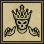 | **Lich Form (Liç Biçimi)** | Mana yenilenmesini ve bazı dirençleri artıran, ateş direncini azaltıp canı yavaşça tüketen bir liçe dönüştürür. Yeniden uygulanana kadar sürer. |
| 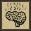 | **Mind Rot (Zihin Çürümesi)** | Hedefin büyü yaparken harcadığı manayı artıran bir lanet uygulamaya çalışır. Süre, büyücünün Spirit Speak (Ruhlarla konuşma) ve hedefin Resisting Spells (Büyü direnci) becerilerine bağlıdır. |
|  | **Pain Spike (Acı Darbesi)** | Hedefe şiddetli acı ve doğrudan hasar verir. Etki sona erdiğinde hedef hâlâ yaşıyorsa kaybettiği canın bir kısmı geri gelir. |
| 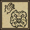 | **Poison Strike (Zehir Darbesi)** | Hedefin merkezinde zehirli bir patlama oluşturur. Ana hedef yüksek zehir hasarı, çevresindeki uygun hedefler daha düşük hasar alır. |
| 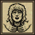 | **Strangle (Boğma)** | Hedefi zehirli dumanlarla boğarak zaman içinde zehir hasarı verir. Her darbenin hasarı büyücünün Spirit Speak (Ruhlarla konuşma) becerisi ve hedefin mevcut dinçliğine bağlıdır. |
| 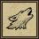 | **Summon Familiar (Yoldaş Çağır)** | Listeden seçilen bir büyülü yoldaş çağırır. Yoldaş sahibini takip eder, onunla savaşır ve türüne göre özel faydalar sağlar. |
| 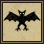 | **Vampiric Embrace (Vampir Kucaklaması)** | Büyücüyü, dinçlik ve mana yenilenmesi artan, ateş direnci azalan bir vampire dönüştürür. Vampir saldırıları can emer. Yeniden uygulanana kadar sürer. |
| 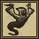 | **Vengeful Spirit (İntikamcı Ruh)** | Hedef veya ruh ölene kadar hedefini her yerde takip eden kötü bir ruh çağırır. Gücü, büyücünün Necromancy (Ölü çağırma) ve Spirit Speak (Ruhlarla konuşma) becerilerine bağlıdır. |
| 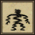 | **Wither (Soldurma)** | Büyücünün çevresindeki uygun hedeflere soğuk hasarı veren dondurucu bir aura oluşturur. |
| 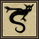 | **Wraith Form (Hortlak Biçimi)** | Bazı element dirençlerini azaltırken fiziksel direnci artıran bir hortlağa dönüştürür. Recall her zaman başarılı olur ve saldırılar mana emer. Yeniden uygulanana kadar sürer. |
| 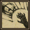 | **Exorcism (Ruh Kovma)** | Yakınında cesedi bulunmayan oyuncu hayaletlerini etki alanından uzaklaştırır. Yalnızca şampiyon bölgelerinde çalışır; aynı grup, lonca, ittifak veya hizip üyelerini etkilemez. |

<!-- spell-catalog:end -->

Beceri kullanımı: [Necromancy (Ölü çağırma)](../beceriler/necromancy.md).

Diğer kitaplar ve malzemeler: [Büyücülük ve büyü kitapları](../oynanis/buyu.md). [Ultoria rehberine dön](../README.md).
