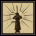
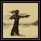
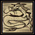
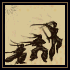
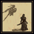
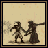
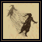
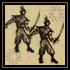

# Ninjitsu (Ninjutsu) kitabı

**Ninjitsu (Ninjutsu) kitabı**, gizlenme, dönüşüm ve özel saldırıyla ilgili sekiz ninja tekniğini içerir. Mevcut başlangıç düzeninde ninja yolu kapalıdır.

## Gerekenler

Okulu destekleyen oyun düzeni, Ninjitsu (Ninjutsu) kitabı ve tekniğin mana, gizlenme ve ekipman koşulları gerekir.

## Kitap nasıl kullanılır

1. Mevcut başlangıç yolunun okulu desteklediğini kontrol et.
2. Kitabın varsa istediğin tekniğin sayfasını aç.
3. Önceki gizlenme veya saldırı koşulunu oku.
4. Desteklenen bir düzende tekniği seçip açıklamadaki eylemi yap.
5. Uygulanmadığında Günlükteki ret mesajını kontrol et.

## Gizlenmeyle ilişkisi

**Backstab (Arkadan Vuruş)** ve **Surprise Attack (Baskın)** açıklamalarını okurken gizlenme koşuluna dikkat et. [Hiding (Gizlenme)](../beceriler/hiding.md) ve [Stealth (Sessiz hareket)](../beceriler/stealth.md) ayrı becerilerdir; Ninjitsu (Ninjutsu) kitabı onları kendiliğinden yükseltmez.

**Animal Form (Hayvan Biçimi)** karakterinin dönüşümünü, **Mirror Image (Ayna Sureti)** ise bir kopyayı anlatır. Bunlar [Animal Taming (Hayvan evcilleştirme)](../beceriler/animal-taming.md) ile hayvan sahiplenmenin karşılığı değildir.

## Mevcut düzende ne beklemelisin

Kitapta teknik adlarının ve Türkçe bilgi kutularının bulunması, kapalı ninja başlangıcını kullanabildiğin anlamına gelmez. Hiding (Gizlenme) ve Stealth (Sessiz hareket) öğrenmek için ninja seçeneğine geçmek zorunda değilsin.

## Büyüler ve Türkçe açıklamaları

Oyunda büyü ve teknik adları özgün İngilizce biçimlerini korur. Parantez içindeki Türkçe ad anlamını açıklar; komut veya makro seçerken İngilizce adı kullanabilirsin. Aşağıdaki açıklamalar, büyünün üzerine gelince görünen Türkçe bilgi kutularıyla aynı terimleri kullanır.

<!-- spell-catalog:start -->

| Simge | Büyü ve Türkçe anlamı | Açıklama |
| --- | --- | --- |
|  | **Focus Attack (Odaklı Saldırı)** | Tek bir saldırı için hem hasarı hem de silahın vuruşta tetiklenen özelliklerinin gerçekleşme şansını artırır. |
|  | **Death Strike (Ölüm Darbesi)** | Hedef beş adımdan fazla hareket edince veya beş saniye geçince doğrudan hasar verir. Hasar saldırganın Ninjitsu (Ninjutsu) becerisine bağlıdır. |
|  | **Animal Form (Hayvan Biçimi)** | Özel faydalar sağlayan bir hayvana dönüşmeyi sağlar. Koşarken kullanılırsa son seçilen hayvan biçimine otomatik geçilir. |
|  | **Ki Attack (Ki Saldırısı)** | Başlatıldığı noktadan rakibe kadar alınan mesafe arttıkça daha fazla hasar verir. Hedefe iki saniyeden kısa sürede ulaşılmalıdır. |
|  | **Surprise Attack (Baskın)** | Gizlenerek yapılan saldırı, rakibin savunmasını kısa süreliğine azaltır. Sonraki beş saniye yeniden gizlenilemez. |
|  | **Backstab (Arkadan Vuruş)** | Gizlenerek yapılan saldırıya, Ninjitsu (Ninjutsu) becerisi ve rakibin izinin sürüldüğü mesafeye bağlı ek hasar kazandırır. |
|  | **Shadowjump (Gölge Sıçrayışı)** | Varış noktasındaki gizlilik kontrolü başarılı olursa gizliliği bozmadan ışınlanmayı sağlar. |
|  | **Mirror Image (Ayna Sureti)** | Dört adım yakınındayken gelen hasarı üstlenebilen bir kopya oluşturur. 1 takipçi yuvası kullanır ve 30–60 saniye sonra kaybolur. |

<!-- spell-catalog:end -->

Beceri kullanımı: [Ninjitsu (Ninjutsu)](../beceriler/ninjitsu.md).

Diğer kitaplar ve malzemeler: [Büyücülük ve büyü kitapları](../oynanis/buyu.md). [Ultoria rehberine dön](../README.md).
