# Spellweaving (Tılsım dokuma) kitabı

**Spellweaving (Tılsım dokuma) kitabı**, alan etkileri, çağırmalar ve dönüşümler içeren farklı bir büyü okuludur. Mevcut tanımlarda büyülerin büyük bölümü kapalıdır.

## Gerekenler

İlgili okulun desteği, kitap, kitapta bulunan büyü ve mana gerekir. Büyü açıklamasında odak veya ek bir koşul geçiyorsa bunu da karşılamak gerekir.

## Kitap nasıl kullanılır

1. Büyüyü seçmeden kullanım durumu sütununu oku.
2. Kitabın varsa büyünün açıklamasını ve gereksinimlerini incele.
3. Desteklenen ve açık bir kullanımda büyüyü seç.
4. İstenirse uygun hedefi göster.
5. Etkiyi ve Günlük mesajını kontrol et.

## Odak ne demek

**Arcane Circle (Büyü Çemberi)** açıklamasındaki odak, okulun etkilerini destekleyen özel bir nesne ve birlikte kullanım kavramıdır. Bunu [Focus (Odaklanma)](../beceriler/focus.md) becerisinin sayısal değeriyle karıştırma.

## Mevcut kullanım durumu

Listedeki **Reaper Form (Ağaç Yaratığı Biçimi)** dışındaki büyüler mevcut tanımlarda kapalıdır. Bu istisna, okulun bütün görevlerini, kitap edinimini veya diğer büyülerini kullanabildiğin anlamına gelmez. Dönüşümün açıklamasında daha yavaş hareket ve ateşe karşı zayıflık gibi bedelleri de oku.

## Büyüler ve Türkçe açıklamaları

Oyunda büyü ve teknik adları özgün İngilizce biçimlerini korur. Parantez içindeki Türkçe ad anlamını açıklar; komut veya makro seçerken İngilizce adı kullanabilirsin. Aşağıdaki açıklamalar, büyünün üzerine gelince görünen Türkçe bilgi kutularıyla aynı terimleri kullanır.

<!-- spell-catalog:start -->

| Simge | Büyü ve Türkçe anlamı | Açıklama | Kullanım durumu |
| --- | --- | --- | --- |
| 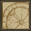 | **Arcane Circle (Büyü Çemberi)** | Büyücü ve en çok dört katılımcı büyü çemberinde durmalıdır. Her biri için bir odak zümrüdü oluşturur. Odak; Spellweaving (Tılsım dokuma) büyülerinin süresini, hasarını, iyileştirmesini ve etki alanını artırır. | Kapalı |
|  | **Gift of Renewal (Yenilenme Armağanı)** | Etki süresince hedefin doğal can yenilenmesini artırır. Zehri bir kez giderebilir; bu durumda büyü hemen sona erer. | Kapalı |
| 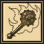 | **Immolating Weapon (Alevli Silah)** | Bir yayı veya yakın dövüş silahını, her vuruşta ek ateş hasarı verecek şekilde geçici olarak büyüler. | Kapalı |
| 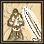 | **Attunement (Uyumlanma)** | Büyücüyü düşmanın silahıyla uyumlandırır. Etki süresince düşman silahından alınan hasarı %50 azaltır. | Kapalı |
| 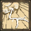 | **Thunderstorm (Gök Gürültüsü)** | Rakiplere fiziksel hasar veren gürültülü bir patlama oluşturur; etki süresince büyüler arasındaki toparlanma süresini de etkileyebilir. | Kapalı |
| 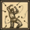 | **Nature's Fury (Doğanın Öfkesi)** | Hedefe zehir hasarı veren bir böcek sürüsü çağırır. Sürü öfkelendikçe verdiği hasar artar. | Kapalı |
| 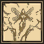 | **Summon Fey (Peri Çağır)** | Büyücüyü takip eden, koruyan ve onun için savaşan küçük bir peri yaratığı çağırır. | Kapalı |
| 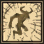 | **Summon Fiend (Şeytani Yaratık Çağır)** | Büyücüyü takip eden, koruyan ve onun için savaşan küçük bir şeytani yaratık çağırır. | Kapalı |
| 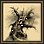 | **Reaper Form (Ağaç Yaratığı Biçimi)** | Saldırı hızı, büyü hasarı ve direnç artışları sağlayan bir ağaç yaratığına dönüştürür. Bu biçimde hareket yavaşlar ve ateşe karşı savunma zayıflar. | Diğer koşullara bağlı |
| 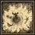 | **Wildfire (Yaban Ateşi)** | Etki alanındaki düşmanlara birkaç saniye boyunca ateş hasarı veren yoğun alevler oluşturur. | Kapalı |
|  | **Essence of Wind (Rüzgârın Özü)** | Alandaki düşmanlara soğuk hasarı veren bir rüzgâr oluşturur. Soğuğun etkisindeki düşmanlar birkaç saniye daha yavaş saldırır ve büyü yapar. | Kapalı |
| 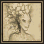 | **Dryad Allure (Orman Perisinin Cazibesi)** | Oyuncu olmayan insansı yaratıkları büyüleyerek büyücüyü takip etmelerini ve korumalarını sağlar. | Kapalı |
| 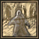 | **Ethereal Voyage (Ruhani Yolculuk)** | Canavarların büyücüyü görmezden geldiği ruhani bir biçimde dolaşmayı sağlar. Süre dolunca veya düşmanca bir eylemde sona erer. Diğer oyuncular büyücüyü görebilir ve ona saldırabilir. Savaşın sıcağında kullanılamaz. | Kapalı |
|  | **Word of Death (Ölüm Sözü)** | Azami canının %5–30'undan daha az canı kalan bir yaratığı doğrudan öldürebilir. Oyuncular ve doğrudan öldürülmeyen yaratıklar bunun yerine enerji hasarı alır. | Kapalı |
|  | **Gift of Life (Yaşam Armağanı)** | Büyücü veya ona bağlı bir evcil hayvan, etki sürerken ölürse dirilme olanağı sağlar. | Kapalı |
| 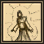 | **Arcane Empowerment (Büyüsel Güçlendirme)** | Etki süresince saldırı ve iyileştirme büyülerini güçlendirir. Çağrılan yaratıklar ve canlandırılan ölüler de güçlenir. | Kapalı |

<!-- spell-catalog:end -->

Beceri kullanımı: [Spellweaving (Tılsım dokuma)](../beceriler/spellweaving.md).

Diğer kitaplar ve malzemeler: [Büyücülük ve büyü kitapları](../oynanis/buyu.md). [Ultoria rehberine dön](../README.md).
