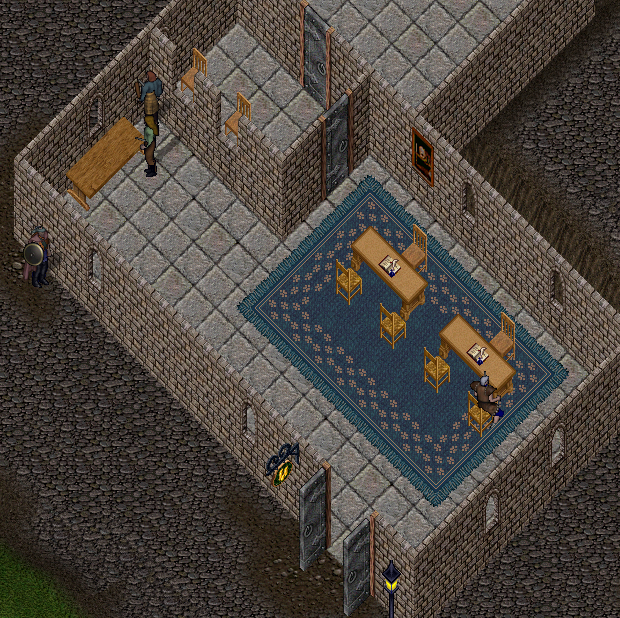
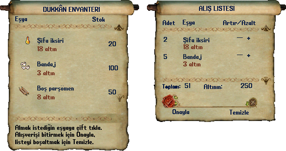
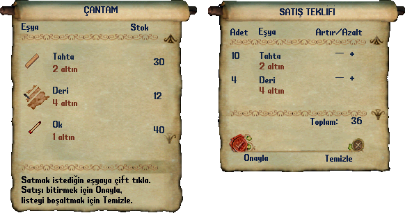

# Ultima Online banka ve ticaret rehberi

**Bankacının yanında `banka`, satıcının yanında `al` veya `sat` yaz.** Banka eşya saklamak, satıcılar ise alışveriş yapmak içindir. Bu kişiler farklı işler yapar.

## Banka kasanı aç

1. Bir bankacıya yaklaş.
2. Enter'a bas, `banka` yaz ve Enter'a bas.
3. Açılan kasadaki eşyalarını kontrol et.
4. Saklayacağın eşyayı çantandan kasanın içine sürükle.
5. Geri alacağın eşyayı kasadan çantana sürükle.

*Bankacılar bankanın içindedir. Birine yaklaşarak kasanı açabilirsin. Eşyayı taşıdıktan sonra kasada göründüğünü kontrol et.*

Altın miktarını sormak için bankacının yanında `bakiye` yazabilirsin. Kasa açılmıyorsa bankacıya yaklaş ve Günlük penceresindeki cevabı oku.

## Satıcıdan eşya al

1. İlgili satıcının yanına git. Örneğin silah için silah satıcısı ara.
2. `al` yaz. `satıcı al` da kullanılabilir.
3. **DÜKKÂN ENVANTERİ** parşömenindeki eşyanın adını, stokunu ve altın fiyatını oku.
4. Almak istediğin eşyaya çift tıkla; **ALIŞ LİSTESİ** bölümüne eklenir.
5. **Adet** ve **Artır/Azalt** alanlarından miktarı kontrol et. **Toplam** tutarı uygun olduğunda **Onayla** düğmesine bas.
6. Eşyanın çantana geldiğini kontrol et.

*Örnek alış listesinde 2 şifa iksiri ve 5 bandaj toplam 51 altın eder. Ürün, fiyat ve miktarlar okuma örneğidir; oyundaki güncel fiyatı satıcıdan oku.*

### Alışveriş parşömenindeki alanlar

| Türkçe alan | Ne gösterir |
| --- | --- |
| DÜKKÂN ENVANTERİ | Satıcının sana satabildiği stok. |
| ALIŞ LİSTESİ | Seçtiğin ve satın almak üzere hazırladığın eşyalar. |
| Eşya | Ürünün adı. |
| Stok | Satıcının elindeki uygun miktar. |
| Adet | Senin işlem için seçtiğin miktar. |
| Artır/Azalt | Seçili miktarı değiştirme alanı. |
| Toplam | Seçtiğin işlem için toplam altın tutarı. |
| Altının | İşlem penceresinde gösterilen altın bilgisi. |
| Onayla | Hazırlanan alış veya satış işlemini tamamlama isteği. |
| Temizle | Hazırladığın işlem listesini boşaltır. |

Eşyayı listeye eklemek henüz satın almak değildir. Yanlış ürün seçtiysen **Temizle** ile listeyi boşaltıp yeniden hazırlayabilirsin. Eşyanın kullanımını anlamak için [bilgi kutusunu](../temeller/esya-ozellikleri.md) oku; fiyat ile savaş gücü aynı bilgi değildir.

## Satıcıya eşya sat

1. Uygun satıcının yanında `sat` yaz.
2. **ÇANTAM** parşömeninde satıcının satın alabildiği eşyaları bul.
3. Satmak istediğin eşyaya çift tıkla; **SATIŞ TEKLİFİ** bölümünü kontrol et.
4. Eşya adını, **Adet** bilgisini ve **Toplam** tutarını yeniden oku.
5. Satışı tamamlamak için **Onayla** düğmesine bas.
6. Çantanı ve altın durumunu kontrol et.

*Örnek satış teklifinde 10 tahta ve 4 deri toplam 36 altın eder. Miktar ve fiyatlar okuma örneğidir; kendi çantanı ve satıcının teklifini kontrol et.*

Satmak istediğin eşya görünmüyorsa o satıcı bunu satın almıyor olabilir. Bir eşyanın yüksek alış fiyatı olması, aynı tutara geri satılacağı anlamına gelmez.

**ÇANTAM** ile **DÜKKÂN ENVANTERİ** farklı tarafları gösterir: birinde senin satılabilir eşyaların, diğerinde satıcının stokları vardır. Alış, satış ve banka kasası aynı pencere değildir.

## Kendi satıcın varsa

Sana ait bir oyuncu satıcısını yönetirken `stok`, `fiyat` ve `kazanç` gibi ayrı komutlar kullanılır. Bunlar şehirdeki her satıcıyı yönetme yetkisi vermez.

Örneğin `fiyat 125` dedikten sonra fiyatını değiştireceğin uygun eşyayı seçersin. `kazanç`, satıcının ödeme koşulları içinde sana verebildiği kazancı almayı dener. Bütün karşılıklar [Türkçe komutlar](../referans/komutlar.md) sayfasındadır.

## Başka oyuncuyla takas

Takas penceresinde karşılığında alacağın eşyanın adını ve miktarını kontrol et. İki tarafın sunduğu eşyaları görmeden onay verme. Bir pencere kapanırsa çantanı kontrol et; alışverişin tamamlandığını varsayma.

**Şimdi dene:** Önce bankanı aç. Saklamak istediğin tek bir eşyayı kasaya taşı ve orada göründüğünü kontrol et.

İlgili rehberler: [Çanta kullanımı](../temeller/canta-ve-esyalar.md), [üretim](uretim-ve-kaynak-toplama.md), [komut listesi](../referans/komutlar.md). Ana sayfa: [Ultima Online oyna](../README.md).
