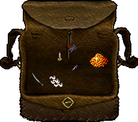

# Ultima Online savaş ve iyileşme rehberi

**Savaşa başlamadan önce silahını kuşan, canını gör ve dönüş yolunu belirle.** İlk denemeni tek bir hedefle yap. Canın hızla düşerse uzaklaş ve iyileş.

## Önce hazırlan

1. [Çantanı aç](../temeller/canta-ve-esyalar.md). Silah, bandaj ve kullanacağın diğer eşyaları bul.
2. Silahını karakter pencerene sürükleyerek kuşan.
3. Durum veya can penceresini görünür bir yere koy.
4. Gereksiz ağırlığı [bankaya bırak](banka-ve-ticaret.md).
5. Tanıdığın bir yere nasıl döneceğini belirle.

*Silahın karakterinin üzerinde görünmelidir. Çantada duran bir silahı henüz eline almamış olabilirsin.*

## Saldırmak

Karakter penceresindeki **Barış / Savaş** düğmesi savaş ve barış durumunu değiştirir. Savaş durumundayken saldırmak istediğin hedefe çift tıklarsın. Yanlış kişiyi seçmemek için önce adını oku.

Bir hedefe saldırmak, onun sana karşılık vermesine yol açabilir. Şehirdeki bir NPC'yi veya başka oyuncuyu deneme hedefi olarak kullanma. İlk alıştırmada deneyimli bir oyuncudan uygun bir yaratık göstermesini isteyebilirsin.

## Hangi silah hangi beceriyi kullanır

| Silah türü | İlgili beceri |
| --- | --- |
| Kılıçlar | [Swordsmanship (Kılıç ustalığı)](../beceriler/swordsmanship.md) |
| Delici silahlar | [Fencing (Eskrim)](../beceriler/fencing.md) |
| Topuzlar | [Mace Fighting (Topuz dövüşü)](../beceriler/mace-fighting.md) |
| Yay ve arbalet | [Archery (Okçuluk)](../beceriler/archery.md) |
| Silahsız dövüş | [Wrestling (Güreş)](../beceriler/wrestling.md) |

Yay için uygun mühimmat da gerekir. Bir silahın hasarı, yalnızca görüntüsüne veya büyüklüğüne bağlı değildir. İlgili [becerilerini](../temeller/yetenekler-ve-gelisim.md) de kontrol et.

## Bandajla iyileşmek

1. Bandaja çift tıkla.
2. Hedef işaretçisi çıkınca kendi karakterine tıkla.
3. İşlemin sonucunu oyun mesajından takip et.

Bandajın etkisi anında bitmeyebilir. Başarısı Healing (İyileştirme) ve ilgili becerilere bağlıdır. Hayvanların tedavisinde Veterinary (Veterinerlik) kullanılır.

## İksirleri ayır

| İhtiyacın | Bakacağın eşya adı |
| --- | --- |
| Eksik canı tamamlamak | Şifa iksiri |
| Zehri gidermek | Panzehir |
| Dinçlik kazanmak | Dinçlik iksiri |

İksire çift tıklayarak kullan. Zehirlenmişsen yalnızca can doldurmaya çalışmak yetmeyebilir; zehir durumunu da kontrol et. Kullanım arasında bekleme gerekiyorsa oyun mesajını oku.

## Muhafız ne zaman çağrılır

`muhafız` veya `muhafızlar`, korunan bölgelerde bir suç için muhafız çağırmayı dener. Bu komut bütün dünyada seni koruyan bir kalkan değildir. Ormandaki her yaratığı bu yolla durduramazsın.

## İlk alıştırman

Tek bir hedef seç. Canını izle. Gerektiğinde geri çekil ve bandajı dene. Çantandaki bütün iyileştirme eşyalarını bitirmeden alıştırmayı sonlandır.

Karakterin öldüyse [geri dönüş adımlarını](olum-ve-geri-donus.md) izle. Büyü kullanacaksan [büyücülük rehberine](buyu.md) geç. Ana sayfa: [Ultima Online oyna](../README.md).
