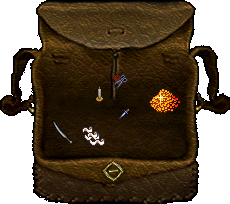

# Ultima Online çanta ve eşya kullanımı

**Çantanı açmak için üst menüde Envanter'e bas.** Kendi karakterine çift tıklayıp karakter penceresindeki çantaya çift tıklamak da aynı işi yapar.

*Açık çanta yanında taşıdığın eşyaları gösterir. Çantanın dışı ve sap boşlukları saydamdır; başlangıç eşyaların mesleğine göre farklı olabilir.*

## Bir eşyayı tanı

Eşyaya tek tıkla ve adını oku. Ayrıntılar için fareyi üzerinde kısa süre beklet. Açılan **bilgi kutusu**, eşyanın adını, varsa kullanım sayısını, gerekli beceriyi, hasarını veya diğer özelliklerini gösterir. Buna hover açıklaması da denir.

Örneğin **gerekli beceri: Swordsmanship (Kılıç ustalığı)** satırı silahın hangi beceriyle kullanıldığını söyler. **dayanıklılık** eşyanın sağlamlığıdır; **dinçlik** ise karakterinin hareket kaynağıdır. [Eşya özellikleri rehberinde](esya-ozellikleri.md) bütün önemli satırların anlamlarını ve nasıl karşılaştırılacağını bulabilirsin.

Eşya adı ve özellikleri Türkçedir; beceri adları İngilizce (Türkçe) biçimindedir. Büyü parşömenlerindeki büyü adı İngilizce kalabilir. Bir kılıç, bandaj ve ekmek aynı biçimde kullanılmaz; önce hangi eşya olduğunu öğren.

Eşya yığınındaki sayı, o türden kaç tane taşıdığını gösterir. Örneğin bir bandaj yığınında çok sayıda bandaj olabilir.

## Çantanın içinde taşı

1. Eşyayı sol düğmeyle tut.
2. Çantada boş bir yere sürükle.
3. Düğmeyi bırak.

Bir eşya geri dönüyorsa taşınamıyor olabilir veya bırakacağın yer uygun değildir. Açıklamayı **Günlük** penceresinden kontrol et.

Yere bıraktığın eşya çantanda kalmaz. Bankaya koymak istediğin eşyayı yere bırakmak yerine [açık banka kasasına](../oynanis/banka-ve-ticaret.md) taşı.

## Silah ve zırh kullan

Silahı veya giysiyi karakter penceresindeki bedeninin üzerine sürükle. Kuşanılırsa karakterinin üzerinde görünür. Çıkarmak için üzerindeki eşyayı çantana sürükle.

Bazı eşyalar iki el ister veya belirli koşullarda kullanılır. Bir eşya takılmıyorsa oyun mesajını oku. Kalkanla iki elli bir silahı aynı anda kullanmaya çalışma.

## Yiyecek ve tüketilen eşyalar

Yiyecek ve birçok iksir çift tıklayarak kullanılır. Bandaj gibi bazı eşyalar önce bir hedef ister. Bandaj kullandıktan sonra kendini veya iyileştirmek istediğin kişiyi seçersin.

İksiri yalnızca renginden tanımaya çalışma; adını da oku. [İyileşme rehberinde](../oynanis/savas-ve-iyilesme.md) can, zehir ve dayanıklılık için farklı ihtiyaçları öğrenebilirsin.

## Çok ağır taşıyorsam

Durum penceresindeki ağırlığı kontrol et. Çok eşya taşımak hareketini zorlaştırabilir. Kullanmayacağın ağır malzemeleri bankaya götür. Kaynak toplarken küçük miktarlarla başlayıp [üretim rehberindeki](../oynanis/uretim-ve-kaynak-toplama.md) sırayı izle.

**Şimdi dene:** Çantandaki bir eşyayı başka bir yere taşı. Ardından karakter pencerendeki bir giysinin adını bul.

İlgili rehber: [Banka ve ticaret](../oynanis/banka-ve-ticaret.md). Ana sayfa: [Ultima Online oyna](../README.md).
