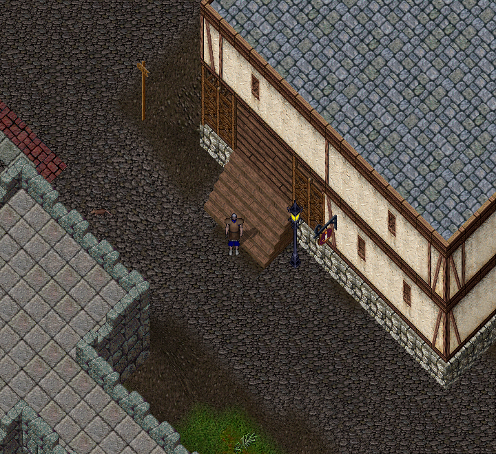
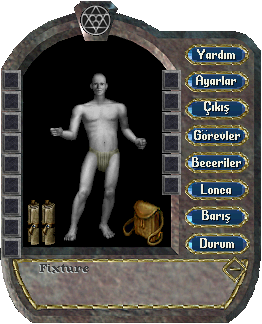
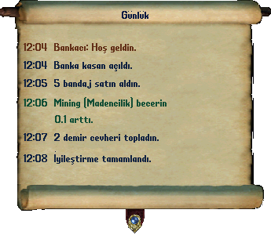

# Ultima Online ekranı ve kontrolleri

**Yürümek için farenin sağ düğmesini, eşya kullanmak için çift tıklamayı kullan.** İlk olarak sakin bir yerde yürüme ve durma alıştırması yap.

*Oyun alanı dünyayı gösterir. Pencere açmak için üst menüde Karakter, Envanter ve Günlük düğmelerini kullanırsın.*

## Farenin dört temel işi

| İşlem | Nasıl yapılır | Deneyebileceğin örnek |
| --- | --- | --- |
| Yürümek | Gitmek istediğin yönde sağ düğmeyi basılı tut | Birkaç adım ilerle, sonra düğmeyi bırak |
| Ad görmek | Sol düğmeyle bir kez tıkla | Çantandaki bir eşyanın adına bak |
| Kullanmak veya açmak | Sol düğmeyle iki kez hızlı tıkla | Kendi karakterini, çantanı veya kapıyı aç |
| Taşımak | Eşyayı sol düğmeyle tut, sürükle ve bırak | Bir eşyayı çantanın başka bir yerine koy |

Sağ düğme birçok oyun penceresini de kapatır. Yürümek isterken bir pencere kapanıyorsa fareyi pencerenin dışındaki oyun alanına götür.

## Sık kullanacağın pencereler

*Karakter penceresinin örnek görünümü. Çerçevenin içi opak siyah, yalnızca dışı saydamdır. Beceriler, Ayarlar, Durum ve Barış düğmelerini burada bulursun.*

| Türkçe ekrandaki ad | İngilizce karşılık | Ne işe yarar |
| --- | --- | --- |
| Karakter | Character / Paperdoll | Giydiklerini ve elindeki eşyaları gösterir |
| Envanter / sırt çantası | Inventory / Backpack | Taşıdığın eşyaları gösterir |
| Durum | Status | Canını ve karakter değerlerini gösterir |
| Günlük | Journal | Kaçırdığın konuşma ve sistem mesajlarını gösterir |
| Beceriler | Skills | Beceri değerlerini ve gelişim tercihlerini gösterir |
| Dünya Haritası | World Map | Bulunduğun yeri ve çevreni anlamana yardımcı olur |
| Ayarlar | Options | Türkçe Seçenekler penceresini açar |
| Barış / Savaş | Peace / War | Saldırı durumunu değiştirir |

Türkçe arayüzde bu düğmeler Türkçedir. İngilizce karşılıklar eski bir anlatımı veya makro eylemini eşleştirebilmen için verilir. Beceriler parşömeninde beceri adları **İngilizce (Türkçe)** biçimindedir; kullanım düğmesi ile artış oklarını karıştırma.

## Günlük ve alışveriş parşömenleri

*Günlükte konuşma, alışveriş ve beceri mesajlarını birlikte okuyabilirsin. Buradaki saat ve mesajlar okuma örneğidir.*

Üst menüden **Günlük** penceresini aç. NPC cevabını, beceri sonucunu veya eşyayı kullanamadığında çıkan mesajı burada yeniden okuyabilirsin. Komut yazacağın yer Günlük değil, konuşma alanıdır.

Satıcıda **DÜKKÂN ENVANTERİ**, **ALIŞ LİSTESİ**, **ÇANTAM** ve **SATIŞ TEKLİFİ** başlıklı Türkçe parşömenler kullanılır. Eşya seçmek ile **Onayla** düğmesine basmak ayrı adımlardır. [Alışveriş rehberinde](../oynanis/banka-ve-ticaret.md) hangi parşömenin neyi gösterdiğini öğren.

## Konuşmak ve komut yazmak

1. Oyun alanına tıkla.
2. Enter'a bas.
3. Mesajını veya komutunu yaz.
4. Göndermek için yeniden Enter'a bas.

Örneğin bankacının yanında `banka` yaz. Başına nokta veya eğik çizgi koyma. [Komut listesinde](../referans/komutlar.md) yazan metni kullan.

Mesaj yazarken bir kısayol devreye giriyorsa önce Enter'a basıp yazı alanını aç. Bir komutun ekranda görünmesi, karşıdaki kişinin onu uyguladığı anlamına gelmez; doğru kişiye yeterince yakın olmalısın.

## Hedef seçmek ne demek

Bazı eylemler senden bir kişi, eşya veya yer seçmeni ister. Buna **hedef seçmek** denir. İşaretçi değişince istenen şeye sol tıkla. Vazgeçmek için Esc tuşuna bas.

Örneğin bandaj kullandıktan sonra kendini seçebilirsin. Hayvanına `git` dediğinde ise gitmesini istediğin yeri seçersin.

Sonraki adım: [Çanta ve eşyalar](canta-ve-esyalar.md). Görüntüyü rahatlatmak için [ayarlar](../yardim/ayarlar-ve-makrolar.md). [Ultima Online başlangıç rehberine dön](../README.md).
