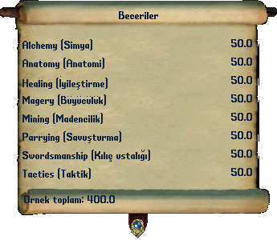

# Ultima Online becerileri ve gelişim

**Beceri, karakterinin bir işi ne kadar iyi yaptığını gösterir.** Ultoria'da adları **İngilizce (Türkçe)** biçiminde okursun: örneğin Swordsmanship (Kılıç ustalığı). Aşağıdaki 58 becerinin her birinin ayrı kullanım rehberi var.

Karakter penceresindeki **Beceriler** düğmesine bas. Beceriler parşömeninin başlığı, grup seçenekleri ve kullanım açıklaması Türkçedir. Önce yapmak istediğin işi seç; sonra ilgili becerinin sayfasından gereken aracı ve kullanım adımlarını öğren.

*Beceri adlarının ve değerlerin okuma örneği. Buradaki 50.0 değerleri örnek veridir; kendi karakterinin değerlerini oyunda kontrol et.*

## Beceriyi nasıl kullanacağını anla

| Kullanım türü | Nasıl başlarsın | Örnek |
| --- | --- | --- |
| Etkin beceri | Beceri satırının kullanım düğmesine bas; istenirse hedef seç | Anatomy (Anatomi), Animal Lore (Hayvan bilgisi) |
| Araçla kullanım | Araca çift tıkla; hedefi veya üretim tarifini seç | Mining (Madencilik), Tailoring (Terzilik) |
| Savaş kullanımı | Uygun silahla saldır veya savunma koşulunu sağla | Archery (Okçuluk), Parrying (Savuşturma) |
| Kitapla kullanım | İlgili kitabı açıp büyü veya tekniği seç | Magery (Büyücülük), Chivalry (Şövalyelik) |
| Pasif destek | İlgili oyun hesabında kendiliğinden değerlendirilir | Focus (Odaklanma), Tactics (Taktik) |

Her satırın ayrıca basılacak bir kullanım düğmesi olması gerekmez. Bir ok işaretine basmakla beceriyi kullanmayı karıştırma: oklar **gelişim tercihini** değiştirir.

## Oyun tarzına göre başlangıç

| Yapmak istediğin iş | Önce açacağın rehberler |
| --- | --- |
| Kılıç ve kalkan | [Swordsmanship (Kılıç ustalığı)](../beceriler/swordsmanship.md), [Parrying (Savuşturma)](../beceriler/parrying.md), [Healing (İyileştirme)](../beceriler/healing.md) |
| Uzaktan savaş | [Archery (Okçuluk)](../beceriler/archery.md), [Tactics (Taktik)](../beceriler/tactics.md) |
| Klasik büyücülük | [Magery (Büyücülük)](../beceriler/magery.md), [Evaluating Intelligence (Zekâ değerlendirme)](../beceriler/evaluating-intelligence.md), [Meditation (Meditasyon)](../beceriler/meditation.md) |
| Şövalyelik | [Chivalry (Şövalyelik)](../beceriler/chivalry.md), [şövalyelik kitabı](../buyu-kitaplari/chivalry.md) |
| Ölü çağırma | [Necromancy (Ölü çağırma)](../beceriler/necromancy.md), [Spirit Speak (Ruhlarla konuşma)](../beceriler/spirit-speak.md) |
| Kaynak ve üretim | [Mining (Madencilik)](../beceriler/mining.md), [Blacksmithy (Demircilik)](../beceriler/blacksmithy.md), [Lumberjacking (Odunculuk)](../beceriler/lumberjacking.md) |
| Hayvanlarla oynama | [Animal Taming (Hayvan evcilleştirme)](../beceriler/animal-taming.md), [Animal Lore (Hayvan bilgisi)](../beceriler/animal-lore.md), [Veterinary (Veterinerlik)](../beceriler/veterinary.md) |
| Ozanlık | [Musicianship (Müzisyenlik)](../beceriler/musicianship.md), [Peacemaking (Yatıştırma)](../beceriler/peacemaking.md), [Provocation (Kışkırtma)](../beceriler/provocation.md) |

## Bütün beceriler

İleri okulların veya tekniklerin adı listede bulunabilir; bu tek başına mevcut karakterinde kullanılabildiği anlamına gelmez. Kapalı veya sınırlı kullanımlar ilgili beceri ve kitap sayfasında açıklanır. Mevcut klasik istemci bütün ileri becerileri aynı listede sunmayabilir.

### Savaş ve savunma

| Beceri | Ne için kullanılır |
| --- | --- |
| [Anatomy (Anatomi)](../beceriler/anatomy.md) | Bir canlının bedensel durumunu değerlendirir; yakın dövüş ve bandajla iyileştirmeyi de destekler. |
| [Archery (Okçuluk)](../beceriler/archery.md) | Yay ve arbaletle uzaktan savaşmanı sağlar. |
| [Fencing (Eskrim)](../beceriler/fencing.md) | Eskrim becerisi isteyen delici yakın dövüş silahlarıyla savaşmanı sağlar. |
| [Healing (İyileştirme)](../beceriler/healing.md) | Bandajla insanları iyileştirmeni sağlar. |
| [Mace Fighting (Topuz dövüşü)](../beceriler/mace-fighting.md) | Topuz dövüşü isteyen silahlarla yakın dövüş yapmanı sağlar. |
| [Parrying (Savuşturma)](../beceriler/parrying.md) | Savaş sırasında gelen uygun saldırıları savuşturmana yardımcı olur. |
| [Poisoning (Zehirleme)](../beceriler/poisoning.md) | Zehri uygun bir silaha veya yiyeceğe uygulamanı sağlar; bazı klasik zehir büyülerini de destekler. |
| [Resisting Spells (Büyü direnci)](../beceriler/resisting-spells.md) | Uygun zararlı büyülerin etkilerine direnç göstermene yardımcı olur. |
| [Swordsmanship (Kılıç ustalığı)](../beceriler/swordsmanship.md) | Kılıç ustalığı isteyen silahlarla savaşmanı sağlar. |
| [Tactics (Taktik)](../beceriler/tactics.md) | Silahla yapılan savaşın hasar hesabını destekleyen beceridir. |
| [Throwing (Fırlatma)](../beceriler/throwing.md) | Fırlatma silahlarıyla ilgili uzak dövüş becerisidir. |
| [Wrestling (Güreş)](../beceriler/wrestling.md) | Silahsız yakın dövüş becerisidir. |

### Büyü ve odaklanma

| Beceri | Ne için kullanılır |
| --- | --- |
| [Bushido (Buşido)](../beceriler/bushido.md) | Samuray teknikleriyle ilgili beceridir. |
| [Chivalry (Şövalyelik)](../beceriler/chivalry.md) | Şövalyelik kitabındaki iyileştirme, arındırma, silah desteği ve yolculuk büyülerini kullanmanı sağlar. |
| [Evaluating Intelligence (Zekâ değerlendirme)](../beceriler/evaluating-intelligence.md) | Hedefin zihinsel durumunu değerlendirir ve klasik büyücünün saldırı büyülerini destekler. |
| [Focus (Odaklanma)](../beceriler/focus.md) | Dinçlik ve mana yenilenmesini destekleyen pasif bir beceridir. |
| [Magery (Büyücülük)](../beceriler/magery.md) | Klasik büyü kitabındaki saldırı, koruma, iyileştirme ve yolculuk büyülerini yapmanı sağlar. |
| [Meditation (Meditasyon)](../beceriler/meditation.md) | Mana toparlamayı destekler. |
| [Mysticism (Mistisizm)](../beceriler/mysticism.md) | Mistisizm kitabıyla ilişkili ileri bir büyü becerisidir. |
| [Necromancy (Ölü çağırma)](../beceriler/necromancy.md) | Ölü çağırma kitabındaki karanlık saldırı, lanet, çağırma ve dönüşüm büyülerini kullanmanı sağlar. |
| [Ninjitsu (Ninjutsu)](../beceriler/ninjitsu.md) | Ninja teknikleriyle ilişkili beceridir. |
| [Spellweaving (Tılsım dokuma)](../beceriler/spellweaving.md) | Tılsım dokuma kitabının becerisidir. |
| [Spirit Speak (Ruhlarla konuşma)](../beceriler/spirit-speak.md) | Ruhların konuşmasını anlamaya yardımcı olur ve Necromancy (Ölü çağırma) etkilerini destekler. |

### Üretim ve kaynak toplama

| Beceri | Ne için kullanılır |
| --- | --- |
| [Alchemy (Simya)](../beceriler/alchemy.md) | İksir üretmeni sağlar. |
| [Arms Lore (Silah bilgisi)](../beceriler/arms-lore.md) | Silah ve zırhları değerlendirmeye yarar. |
| [Blacksmithy (Demircilik)](../beceriler/blacksmithy.md) | Metal silah, zırh ve benzeri demirci eşyaları üretmeni sağlar. |
| [Bowcraft/Fletching (Yay ve ok yapımı)](../beceriler/bowcraft-fletching.md) | Yay ve okçuluk malzemeleri yapmanı sağlar. |
| [Carpentry (Marangozluk)](../beceriler/carpentry.md) | Ahşap eşya ve mobilya üretmeni sağlar. |
| [Cooking (Aşçılık)](../beceriler/cooking.md) | Çiğ malzemelerden yiyecek hazırlamanı sağlar. |
| [Fishing (Balıkçılık)](../beceriler/fishing.md) | Oltayla sudan balık ve uygun kaynakları toplamanı sağlar. |
| [Imbuing (Büyü işleme)](../beceriler/imbuing.md) | Eşyalara büyülü özellik işleme sistemiyle ilişkili beceridir. |
| [Inscription (Yazıt işleme)](../beceriler/inscription.md) | Boş parşömenlere büyü yazmanı sağlar ve bazı klasik büyü etkilerini destekler. |
| [Lumberjacking (Odunculuk)](../beceriler/lumberjacking.md) | Uygun ağaçlardan odun toplamanı sağlar. |
| [Mining (Madencilik)](../beceriler/mining.md) | Uygun kaya ve maden alanlarından cevher toplamanı, cevheri külçeye dönüştürme zincirinde çalışmanı sağlar. |
| [Tailoring (Terzilik)](../beceriler/tailoring.md) | Kumaş ve deri kullanarak giysi ve uygun zırhları üretmeni sağlar. |
| [Tinkering (Tamircilik)](../beceriler/tinkering.md) | Çeşitli alet ve mekanik eşyaları üretmeni sağlar. |

### Hayvanlar ve müzik

| Beceri | Ne için kullanılır |
| --- | --- |
| [Animal Lore (Hayvan bilgisi)](../beceriler/animal-lore.md) | Hayvanları değerlendirmeni sağlar ve evcil hayvanlarla oynayan karakterleri destekler. |
| [Animal Taming (Hayvan evcilleştirme)](../beceriler/animal-taming.md) | Uygun vahşi bir hayvanı evcilleştirmeyi dener. |
| [Discordance (Ahenksizlik)](../beceriler/discordance.md) | Oyunda Discordance (Ahenksizlik) adıyla görünür. |
| [Herding (Çobanlık)](../beceriler/herding.md) | Uygun bir hayvanı seçtiğin noktaya yönlendirmeyi dener. |
| [Musicianship (Müzisyenlik)](../beceriler/musicianship.md) | Müzik aleti çalma becerisidir. |
| [Peacemaking (Yatıştırma)](../beceriler/peacemaking.md) | Müzikle çevrendeki uygun canlıların çatışmasını yatıştırmayı dener. |
| [Provocation (Kışkırtma)](../beceriler/provocation.md) | Müzikle bir canlıyı diğerine saldırması için kışkırtmayı dener. |
| [Veterinary (Veterinerlik)](../beceriler/veterinary.md) | Bandajla uygun hayvanları iyileştirmeni sağlar. |

### Keşif ve bilgi

| Beceri | Ne için kullanılır |
| --- | --- |
| [Begging (Dilencilik)](../beceriler/begging.md) | Uygun bir NPC’den küçük bir yardım istemeni sağlar. |
| [Camping (Kampçılık)](../beceriler/camping.md) | Kamp ateşi ve kamp kurma ile ilişkili beceridir. |
| [Cartography (Haritacılık)](../beceriler/cartography.md) | Harita çizimiyle ilgili beceridir. |
| [Detecting Hidden (Gizlenenleri bulma)](../beceriler/detecting-hidden.md) | Yakınındaki gizlenmiş canlıları ortaya çıkarmayı dener. |
| [Forensic Evaluation (Adli inceleme)](../beceriler/forensic-evaluation.md) | Bir cesedi inceleyerek ölümle ilgili bilgi edinmeyi dener. |
| [Hiding (Gizlenme)](../beceriler/hiding.md) | Bulunduğun yerde gizlenmeyi denersin. |
| [Item Identification (Eşya tanıma)](../beceriler/item-identification.md) | Bir eşyayı inceleyerek hakkında bilgi edinmeni sağlar. |
| [Lockpicking (Kilit açma)](../beceriler/lockpicking.md) | Maymuncukla uygun mekanik kilitleri açmayı denersin. |
| [Remove Trap (Tuzak sökme)](../beceriler/remove-trap.md) | Uygun bir kaptaki tuzağı etkisizleştirmeyi dener. |
| [Snooping (Çanta karıştırma)](../beceriler/snooping.md) | Başka bir canlının çantasını inceleme denemesiyle ilişkilidir. |
| [Stealing (Hırsızlık)](../beceriler/stealing.md) | Uygun bir eşyayı çalma denemesiyle ilişkilidir. |
| [Stealth (Sessiz hareket)](../beceriler/stealth.md) | Gizlenmiş durumdayken görünmeden hareket etmeyi destekler. |
| [Taste Identification (Tat tanıma)](../beceriler/taste-identification.md) | Yiyecek, içecek ve uygun maddeleri tanımaya yardımcı olur. |
| [Tracking (İz sürme)](../beceriler/tracking.md) | Yakındaki uygun canlıların izini arar ve seçtiğin izi takip etmene yardımcı olur. |

## Artırma azaltma ve kilitleme

| İşaret | Ne seçmiş olursun |
| --- | --- |
| Yukarı ok | Bu becerinin artmasına izin verirsin. |
| Aşağı ok | Toplamda yer gerektiğinde bu becerinin azalmasına izin verirsin. |
| Kilit | Becerinin mevcut temel değerini korumayı seçersin. |

Her becerinin ve becerilerinin toplamının bir sınırı vardır. Hazır meslekle başlayan karakter toplam sınırına yakın veya sınırda olabilir. Yeni beceri çalışırken yer açmak gerekirse, azalmasını gerçekten istediğin beceriyi seç. Aşağı ok olan bir becerideki kaybın yeni becerideki artışla aynı büyüklükte olacağını varsayma.

### Temel değer ile görünen değer

Temel değer çalışarak veya eğitimle kazandığın beceridir. Görünen değer nitelik ve eşya katkılarıyla farklı olabilir. Bir takıdaki **beceri +…** satırı, o beceriyi kalıcı olarak eğittiğin anlamına gelmez. Eşyayı çıkardığında katkı değişebilir.

## Kullanarak gelişmek

Bir işi başarıyla seçebilmek ile o beceride artış kazanmak farklıdır. İlgili aracı, uygun hedefi ve tarif gereksinimini sağla. Gelişim kilidini ve toplam sınırını kontrol et. Denemenin neden başlamadığını veya bittiğini **Günlük** penceresinden oku.

Üretim denemesi malzeme, büyü denemesi mana veya yük tüketebilir. Önce az miktarla kullanım sırasını öğren; zor bir tarifi sürekli seçmek tek başına hızlı gelişim sağlamaz.

## Öğretmenden eğitim istemek

Uygun NPC'nin yanında `eğit` yaz. Öğretebildiği becerileri ve ödeme koşullarını oku. Örneğin `eğit kılıç`, Swordsmanship (Kılıç ustalığı) için eğitim ister. Türkçe adın eğitimdeki kısa karşılığı farklı olabilir; [doğrulanmış eğitim yazımlarını](../referans/komutlar.md) kullan.

Her NPC her beceriyi öğretemez. Mevcut değerin, öğretmenin bilgisi ve ödeme koşulları sınır koyabilir. Bir becerinin burada sayfasının olması, her öğretmende o beceri için eğitim bulunduğu anlamına gelmez.

## Güç çeviklik ve zekâ

**Strength (Güç)**, **Dexterity (Çeviklik / DEX)** ve **Intelligence (Zekâ / INT)** temel niteliklerdir. Can, dinçlik ve mana da kaynak değerleridir. Bunları 58 becerinin toplamıyla karıştırma.

**Şimdi dene:** Kullanmak istediğin becerinin sayfasını aç. Gerekli aracı bul, tek bir deneme yap ve ardından Günlük mesajını oku.

İlgili rehberler: [Eşya bilgi kutuları](esya-ozellikleri.md), [büyü kitapları](../oynanis/buyu.md), [üretim](../oynanis/uretim-ve-kaynak-toplama.md). [Ultoria rehberine dön](../README.md).
