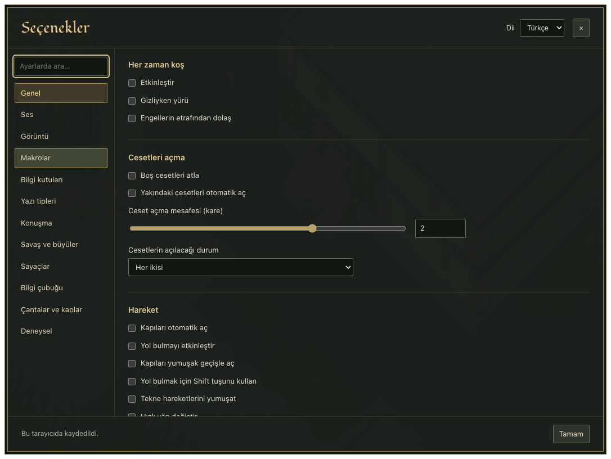
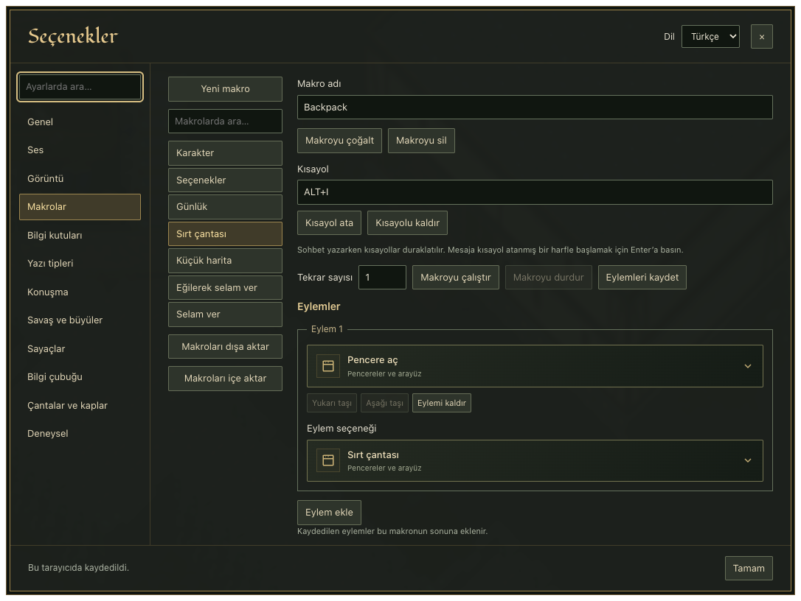

# Ultoria ayarları ve makrolar

**Karakter penceresindeki Ayarlar düğmesi, Türkçe Seçenekler menüsünü açar.** Önce görüntüyü ve yazıları rahat okuyacağın hâle getir. Kısayolları daha sonra ekleyebilirsin.

## Rahat okuyacağın bir ekran kur

1. Kendi karakterine çift tıkla.
2. **Ayarlar** düğmesine bas.
3. Dil alanından **Türkçe**yi seç.
4. Görüntü bölümündeki oyun alanı ve yakınlaştırma seçeneklerine bak.
5. Yazı tipleri ve konuşma bölümlerindeki metin seçeneklerini incele.
6. Bir ayarı değiştir, menüyü kapat ve sonucu oyunda kontrol et.

*Soldan bir bölüm seçebilirsin. Arama alanına aradığın ayarın adını yazarak listede bulabilirsin.*

Birden çok ayarı aynı anda değiştirmek yerine tek tek dene. Hangi değişikliğin işine yaradığını görmek kolaylaşır.

## Makro nedir

**Makro**, bir oyun eylemini veya kısa bir eylem sırasını bir kısayolla çalıştırmanı sağlar. Örneğin çantanı açmak için bir tuş seçebilirsin. Önce aynı işi fareyle yapmayı öğren.

## İlk makron çantayı açsın

1. Seçenekler içinde **Makrolar** bölümünü aç.
2. Yeni bir makro ekle ve “Çantamı aç” gibi anlaşılır bir ad ver.
3. Eylem ekleme alanından **Pencere aç (Open)** eylemini seç.
4. Alt seçenek olarak **Sırt çantası (Backpack)** seç.
5. Kullanmadığın bir tuş birleşimini ata.
6. Menüden çıkıp kısayolu dene.

*Makronun adı ne yapacağını hatırlatır. Kısayol ve eylem ayrı ayarlardır.*

Kısayol başka bir işlemle çakışıyorsa ekrandaki uyarıyı oku ve farklı bir birleşim seç. Sohbet yazarken önce Enter'a bas; normal harfleri kısayol olarak seçmek yazmayı zorlaştırabilir.

## Hedef isteyen eylemler

Büyü veya bandaj gibi bazı işlemler bir hedef ister. Tek bir eylemi eklemek, hedefini kendiliğinden seçmeyebilir. Önce hedef seçiminin nasıl çalıştığını [kontroller sayfasında](../temeller/ekran-ve-kontroller.md) öğren.

Beceri seçerken İngilizce (Türkçe) adı eşleştir. Büyü adı özgün İngilizce biçimiyle kalır; örneğin Night Sight adını [kitaptaki Türkçe açıklamasıyla](../buyu-kitaplari/magery.md) karşılaştırabilirsin. Bir makro, büyünün mana, beceri veya açık olma koşullarını kaldırmaz.

## Bilgi kutularını rahat oku

Seçeneklerde **Bilgi kutuları** bölümünü aç. Bir eşyanın veya büyünün üzerinde bekleyerek metnin okunabilir olduğunu dene. Kutudaki hasar, dayanıklılık ve büyü maliyeti satırları için [özellikler rehberini](../temeller/esya-ozellikleri.md) kullan.

## Ayarlarını sakla

Seçenekler ve pencere yerleşimleri bu tarayıcıda saklanır. Başka bir tarayıcıya geçtiğinde aynı düzen kendiliğinden gelmeyebilir. Tarayıcı verilerini silmek yerel düzenini de silebilir.

Makrolar ve kısayollar için JSON dışa aktarma seçeneğini kullanarak yedek alabilirsin. İçe aktardıktan sonra atamaları gözden geçir. Bu dosya bir karakter veya dünya yedeği değildir.

İlgili rehberler: [Ekran ve kontroller](../temeller/ekran-ve-kontroller.md), [sorun giderme](sorun-giderme.md). Ana sayfa: [Ultima Online oyna](../README.md).
